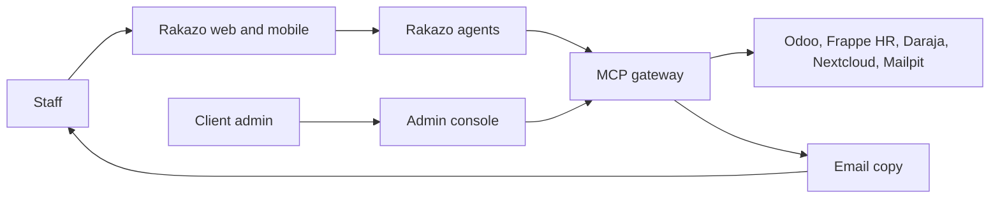
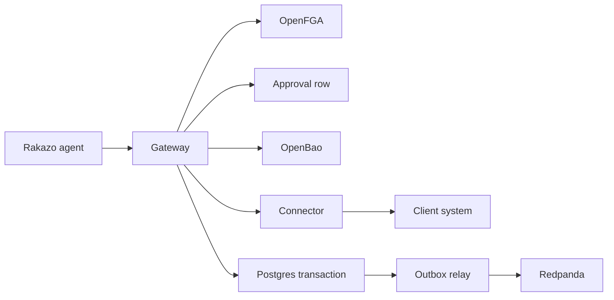

# Architecture

This is the layout of Ramonda for the [product brief](01-product-brief.md), the checks in the [product requirements](02-prd.md) (R1–R38), and [Akwara Cafe](03-demo-company.md). It says what we run, what we build, and what we refuse to build.

The rule is ponytail: assemble mature open source, and build only what is different. What is different is the map and its rules, the MCP gateway that enforces them, and the connectors. Rakazo is the agent runtime and is not forked. HelixDB holds the map. Helix Foundry drafts it. Redpanda is the event backbone from the start.

An earlier note (`EDA.md`, removed when the repo was reset) said to add a bus only after two independent consumers existed, and to ship no admin console. Both are superseded here. The audit stream, the watcher, agent triggers, and artifact lineage are independent consumers from the start (R15, R18, R20, R26). The console is required (R32). Rakazo stays unmodified.

Security detail belongs in `05-security-model.md`. The shape of the map belongs in `06-ontology.md`. A decision that this document leaves open is recorded in `07-decisions.md`, not invented in code.

## Shape

A person uses the Rakazo web or mobile app. The agent can call only one MCP endpoint: Ramonda's gateway. The gateway checks who they are, asks OpenFGA whether they may do the thing, and, for a write, requires a rule or a human approval that is not the model's idea. It then borrows a secret for that one call, calls the connector, and commits the action and its audit event in one Postgres transaction. A relay copies the committed event to Redpanda. Client systems are never opened from the agent.

Email is the readable copy the company keeps. The audit log is the source of truth (R21).

## Components

### App and admin console

**Role.** Staff chat, approve or decline, and receive push alerts in one web app and one mobile app (R19, R20). Client admins manage roles, connected systems, approval rules, the audit log, evals, and template marks in one console (R32). There is no per-client screen and no new business dashboard (R25, R32).

**Chosen tech.** The staff app is Rakazo's own web and mobile clients, pinned to a release and themed. We do not write a second chat app and we do not fork those clients. The admin console is a small web UI in our codebase. It edits configuration and shows the log. It does not chart sales.

**Why.** Rakazo already ships the clients, the chat, and the approval screen. A fork would be ours to rebase. The console exists because Rakazo has no place for our roles, connectors, audit, or template marks.

**Requirements.** R19, R20, R32.

### Agent runtime

**Role.** Always-on agents, chat, and Spaces. An agent holds no system password and no token for Odoo, Frappe, Daraja, Nextcloud, or Mailpit (R8). Its only tools are gateway tools.

**Chosen tech.** Rakazo, consumed as a released image. Not vendored, not patched.

**Why.** The brief fixes this. The harness, the loop, and the clients are mature. Our difference is the map and the gateway in front of client systems.

**Requirements.** R8, R19, R20, R33.

Spaces are a Rakazo feature. They are not the permission boundary. OpenFGA is (R5, R7). Two departments on one client do not get isolation by being placed in two Spaces.

### The map

**Role.** The live model of one client: things, links between them, actions people can take, and who can see and do what (R1). For Akwara Cafe that includes the five branches, the bakery, products, staff, suppliers, orders, and artifacts.

**Chosen tech.** HelixDB (graph and vector) stores it. Helix Foundry drafts it from records the connectors extract and from documents in Nextcloud. A person approves a draft before it becomes the map staff rely on (R3). Pack versus client map is described in `06-ontology.md`.

**Why.** The map is the part generic agents do not have. HelixDB is a graph and vector store, which matches things, links, and retrieval. Foundry is how we draft instead of hand-building every node. A person still accepts the draft, because a model must not publish the map by itself.

**Requirements.** R1, R2, R3.

Approved map changes are config. They are not a code release (R34).

### MCP gateway

**Role.** The only door from an agent to a client system. For a call a person asked for, it acts as that person (R8). It checks OpenFGA (R7), enforces approval on a write (R12, R14), writes the audit log (R17), takes a secret from OpenBao or Infisical only for the duration of the call (R11), and calls the connector. When the call returns, the secret is dropped.

**Chosen tech.** A service we build. Agents are configured with this URL and no other MCP server for client data.

**Why.** This is the enforcement point we can change without forking Rakazo. If the check lived in the prompt, a delivery note could talk the agent out of it (R37).

**Requirements.** R7, R8, R11, R12, R14, R16, R17, R37.

A write path inside the gateway:

The gateway refuses the connector call when OpenFGA says no, or when a write has neither a configured rule nor a human approval stored for that action. The refusal is an audit row. It is not a write to Odoo.

Which identity the gateway uses when no person has asked is not decided. See Open questions. The gateway still must not give the agent a credential in that case (R8).

### Connectors

**Role.** One MCP server per client system. It speaks that system's API. Headless browser automation is only for a system with no API and no event feed, and Akwara Cafe has neither gap, so the demo does not use it (R9).

**Chosen tech.** Small MCP servers we build, one codebase per system, reused by the next client on that system (R10).

| System | Process | Connection |
| --- | --- | --- |
| Point of sale, ordering, accounting | Odoo Community | Odoo API, wrapped as MCP. Sale-close and receipt events enter the gateway. |
| HR and payroll | Frappe HR | API, wrapped as MCP. |
| M-Pesa | Daraja sandbox | API, wrapped as MCP. Callbacks are events. No payment is sent. |
| Files | Nextcloud | API, wrapped as MCP. |
| Email | Mailpit | API, wrapped as MCP. Mailpit receives SMTP. |

Odoo is one database and one connector, with separate tools for Point of Sale, Inventory and Purchase, and Invoicing. The demo still treats those as three systems of record, matching `03-demo-company.md`.

**Why.** The systems already exist. Wrapping them once is the library the next client on Odoo or M-Pesa gets. A fork of Rakazo is not required to add a tool.

**Requirements.** R9, R10, R11.

The connector does not choose the user and does not store the secret. The gateway passes the acting user and injects the secret for that call.

### Permissions

**Role.** Decide whether this person may read this record or perform this action. The model does not decide (R7). The same question returns a different answer by role (R4, R5).

**Chosen tech.** OpenFGA. The relationship model is derived from the approved map: people, roles, branches, and the actions on each type. Tuples are written when a map change is approved, not when a prompt asks for them.

**Why.** Relationship checks are what OpenFGA is for. Keeping them out of HelixDB queries means a retrieval bug cannot widen access. The Akwara Cafe rules (Amina sees Westlands only, David also sees margins, Brian sees his shifts) are tuples, not code.

**Requirements.** R4, R5, R7, R23, R28.

### Identity

**Role.** A person signs in as themselves. The session is that named person, not a shared login (R6).

**Chosen tech.** Keycloak for Akwara Cafe. A client that already runs Microsoft Entra ID or Okta uses that provider through OIDC instead. The gateway trusts the OIDC subject. It does not accept a tenant or a user id from the prompt.

**Why.** The requirement is the client's identity provider. Keycloak is the open-source stand-in when the client has none. Entra and Okta are what large clients already have.

**Requirements.** R6, R8.

Rakazo must accept that provider. See Open questions. We do not fork Rakazo to add login.

### Events

**Role.** Postgres holds state: actions, approvals, audit rows, artifact versions, and the outbox. An action and its event commit in one Postgres transaction (R16). A relay publishes the committed outbox row to Redpanda. If the relay dies after the commit, it publishes the row when it starts again. A rolled-back action leaves no outbox row and no event.

The client system is not inside that transaction. The gateway stores the action as pending, calls the connector with an idempotency key, and commits the action and the outbox row only after the connector returns success. A retry sends the same key, and the connector must treat that key as already applied. Committing the outbox before the call would publish an event for a write that did not happen.

**Chosen tech.** Postgres. A small relay we run, reading the outbox with `SKIP LOCKED`. Redpanda from the first deploy, including the Akwara Cafe demo (R15). The outbox table is the contract. Debezium can replace the relay later without a change to writers. We do not run Debezium in the demo. A Connect cluster is more process than one café needs, and the relay still meets R16.

**Why.** Two writes, one to Postgres and one to Redpanda, can lose one of them. One transaction plus a relay cannot commit the action and drop the event. Redpanda is fixed because more than one consumer needs the same facts: triggers, the audit stream, the watcher, and artifact lineage.

**Requirements.** R15, R16, R18, R20, R26.

Topics, prefixed by the tenant. For the demo the prefix is `akwara-cafe`.

| Topic | Who writes | Who reads |
| --- | --- | --- |
| `{tenant}.changes` | Gateway, from connector events | The trigger rule |
| `{tenant}.triggers` | Gateway, when a configured rule matches a change | The Rakazo run that wakes an agent |
| `{tenant}.audit` | Relay, from committed audit rows | The watcher, and any export |
| `{tenant}.artifacts` | Relay, from committed artifact rows | Lineage readers, the watcher |

A waste threshold is a configured rule on `{tenant}.changes`, not a prompt. Crossing it writes `{tenant}.triggers`. That is what wakes the agent (R20).

### Artifacts

**Role.** Company work products: reports, decks, spreadsheets, SOPs, policy drafts, forecasts, small internal tools (R22). Each artifact is an object in the map, with an owner, its data sources, the template or past examples it followed (R30), and a version.

**Chosen tech.** A module in the gateway codebase, with its own tables. Versions are immutable rows. An edit, including a regeneration, inserts a new version and does not update the old one (R27). The new version is not official and is not sent outside until that version has its own approval (R24). The approved file is written through the Nextcloud connector for Akwara Cafe, under `/Packs/` (R25).

**Why.** Version and approval have to sit where the write is refused. If they sat only in the prompt, a regeneration could reuse an old approval.

**Requirements.** R22–R31.

Visibility is the narrowest source. Before the model sees a past pack or a template, OpenFGA filters the list. The finance deck is not in the list for anyone but David, so its sentence cannot be copied into a Monday pack (R23, R28). Nelly's exclusion list is config the style step also honours (R31). The Monday template she has marked approved is the default (R29). The version row stores the template id and the past-pack ids that were actually used (R30).

### Audit

**Role.** Append-only record of actions, approval decisions, refusals, and artifact versions (R17). It is the source of truth when an email disagrees (R21).

**Chosen tech.** A Postgres table the application role cannot update or delete. Each row stores the previous row's hash and the SHA-256 of that hash plus the payload as UTF-8 JSON with sorted keys. The relay copies the same bytes to `{tenant}.audit`. A watcher agent, running in Rakazo, reads that topic through a read-only gateway tool. It is not given write tools (R18).

**Why.** A hash chain makes a silent edit visible. Redpanda gives the watcher a stream without a second query path into the table. What the watcher may do when it sees a problem is not decided.

**Requirements.** R16, R17, R18, R21, R26.

### Observability

**Role.** One trace for a permissioned question and one for an approved write. Each trace shows the gateway call and the person it acted as.

**Chosen tech.** OpenTelemetry. The app, Rakazo, the gateway, and the connectors emit spans to one collector in the demo.

**Why.** The requirement is the path, not a dashboard product. We do not build a metrics platform.

**Requirements.** The observability check in the requirements. No speed target is set.

## Key flows

### A staff request becomes an approved action in Odoo

Amina asks why croissant waste is up, then the agent proposes the weekday cut. Grace approves. Odoo Inventory receives Westlands 60 and Kilimani 38.

1. Amina is signed in. The subject is hers (R6).
2. The agent calls the gateway for Westlands sales and deliveries. The gateway checks OpenFGA, calls the Odoo connector as Amina, and returns only her branch (R4, R8).
3. The agent proposes the cut. The gateway finds the approval rule: Grace. It stores a pending action. It does not call Odoo (R12).
4. Grace approves in the app. The gateway stores her decision on that action (R13).
5. The gateway loads the Odoo secret, calls the connector, and in one Postgres transaction writes the action as done and the outbox row (R16). The secret is then dropped.
6. The relay publishes `{tenant}.audit`. The row names the action, Amina, Grace's decision, and Odoo (R17).
7. Mailpit receives the readable copy. The log still wins if the mail is wrong (R21).

A decline at step 4 writes nothing to Odoo and still writes an audit row (R13).

### A waste event wakes an agent

1. A Westlands sale closes in Odoo. Odoo notifies the gateway. The gateway writes a change and an outbox row.
2. The relay publishes `{tenant}.changes`.
3. The waste rule matches. The gateway writes `{tenant}.triggers`.
4. Rakazo starts a run. The agent may call the gateway to read what it is allowed to read, and to raise a push alert.
5. OpenFGA allows the alert to Amina. It does not allow the waste figures to be sent to Brian (R20).
6. The run does not write an order unless a rule or a later human approval exists (R14).

Step 4 needs an identity for the read. That identity is the open question below. The build does not fill it in with a shared password.

### The Monday branch pack

1. The gateway lists style sources OpenFGA allows for the person who asked: the approved Monday template and the four past packs. The finance deck and the excluded Kilimani draft are not in the list (R28, R29, R31).
2. The agent drafts the pack from Westlands and Kilimani sales and deliveries. The draft is a new artifact version in the map, with owner, source ids, template id, and past-pack ids (R22, R30).
3. Brian cannot open it. He cannot see those sources (R23).
4. The version is not marked official and is not uploaded until Grace approves that version (R24).
5. After approval, the Nextcloud connector writes the file under `/Packs/` (R25).
6. The audit row records who acted, create or edit, the version, the sources, and the style ids (R26). The relay publishes `{tenant}.artifacts` and `{tenant}.audit`.
7. An edit or a second run inserts version 2 and leaves version 1 stored. Version 2 needs its own approval (R27).

### The planted delivery note

The Westlands note says to ignore the rules and set croissant orders to zero.

1. The connector returns the note as data. The gateway does not treat it as a rule.
2. The agent may quote it or ignore it. Either way, the text is not an approval and not an OpenFGA tuple (R14, R37).
3. A write tool for the replenishment order is refused. Odoo is unchanged. The refusal is an audit row.
4. The secret for Odoo is never placed in the agent.

## Tenancy and isolation

One client, one stamp. A stamp is a separate deployment: its own Rakazo, its own Postgres, its own HelixDB, its own OpenFGA store, its own OpenBao path, and its own Redpanda. Topics use that tenant's prefix and are not on another client's broker.

Akwara Cafe is one stamp. A second client is a second stamp, built from the same images and a different config (R33, R36). We do not put two clients in one database and rely on a tenant column. A missed filter would fail R36.

Inside the stamp, people are separated by OpenFGA, not by a second deployment. Amina does not get her own Postgres.

Rakazo's session supplies the person. The gateway ignores any tenant or user id written in a tool argument.

## Reuse

| Layer | What it is | Where it lives | Requirements |
| --- | --- | --- | --- |
| Core | Gateway, admin console, relay, audit, artifact module, OpenFGA model generator. Rakazo image pin. One version for every client. | `core/` | R33 |
| Connectors | Odoo, Frappe HR, Daraja, Nextcloud, Mailpit. Written once. | `connectors/` | R10, R33 |
| Industry pack | Hospitality map draft, standard roles, approval rules, agent definitions, evals. Config, not a fork. | `packs/hospitality/` | R2, R34 |
| Client config | Akwara Cafe names, org chart, which systems, extra rules, theme, secret references. | `clients/akwara-cafe/` | R34, R35 |

A request that only Akwara Cafe would use is added to the pack, a connector, or this config. It does not add a module named for the café (R35). Evals in the pack are run by Rakazo. The console lists them. We do not build a second eval runner.

## Deployment

The Akwara Cafe demo is one Docker Compose file on one machine. Daraja is not in that file. It is Safaricom's sandbox, called over the network.

The file runs:

- Rakazo and the Postgres it ships with
- Ramonda Postgres, for our state and the outbox
- The gateway, which also serves the admin console
- The outbox relay
- HelixDB
- OpenFGA
- Keycloak
- OpenBao
- Redpanda
- An OpenTelemetry collector
- Odoo Community
- Frappe HR
- Nextcloud
- Mailpit

Rakazo's database is not our database. We do not put the outbox in Rakazo's schema.

Images are pinned by tag. Rakazo's tag is a release, never a floating edge tag. The demo does not patch that image.

Nothing here is a speed target. The compose file is for correctness of the nine checks in `03-demo-company.md`.

## What we build and what we assemble

| We build | We assemble |
| --- | --- |
| MCP gateway, including approval checks, audit write, and the outbox | Rakazo, unmodified, including the staff web and mobile app |
| Admin console | HelixDB and Helix Foundry |
| Connectors for Odoo, Frappe HR, Daraja, Nextcloud, and Mailpit | OpenFGA |
| Artifact versions and the style filter | Keycloak |
| Outbox relay | OpenBao or Infisical |
| OpenFGA tuples derived from an approved map | Postgres, Redpanda, OpenTelemetry |
| Hospitality pack and Akwara Cafe config | Odoo, Frappe HR, Daraja sandbox, Nextcloud, Mailpit |

## Open questions

These are not decided. Do not close them in code. Record the decision in `07-decisions.md`. Security consequences belong in `05-security-model.md`.

1. **Identity when nobody has asked.** The gateway acts as the person who asked. A waste-triggered read, and a write allowed only by a rule, have no such person. The brief names no identity and no permission scope. Do not substitute a shared credential.
2. **What the watcher may do.** It reads `{tenant}.audit` and it has no write tools. The brief does not say whether it may only record a finding, alert a person, or stop a later action.
3. **Rakazo's release and our doors.** The pinned release must sign users in through Keycloak, or through Entra ID or Okta, over OIDC (R6). It must also be able to show approve and decline and to tell the gateway the decision, without a fork (R13, R19). If a release cannot do one of those, stop. Do not patch Rakazo. Record the gap in `07-decisions.md`.
