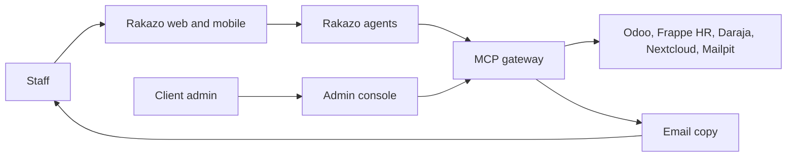
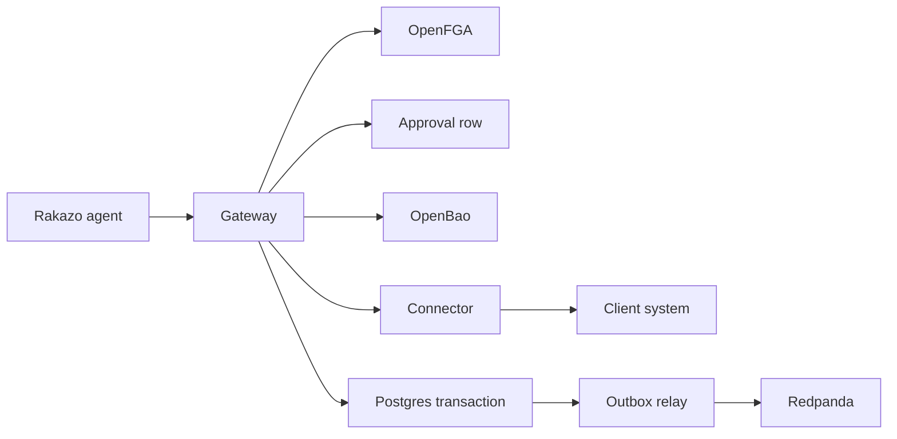

# Architecture

This is the layout of Ramonda for the [product brief](01-product-brief.md), the checks in the [product requirements](02-prd.md) (R1–R38), and [Akwara Cafe](03-demo-company.md). It says what we run, what we build, and what we refuse to build.

The rule is ponytail: assemble mature open source, and build only what is different. What is different is the map and its rules, the MCP gateway that enforces them, and the connectors. Rakazo is the agent runtime and is not forked. HelixDB holds the map. Helix Foundry drafts it. Redpanda is the event backbone from the start.

An earlier note (`EDA.md`, removed when the repo was reset) said to add a bus only after two independent consumers existed, and to ship no admin console. Both are superseded here. The audit stream, the watcher, agent triggers, and artifact lineage are independent consumers from the start (R15, R18, R20, R26). The console is required (R32). Rakazo stays unmodified.

Security detail belongs in `05-security-model.md`. The shape of the map belongs in `06-ontology.md`. A decision that this document leaves open is recorded in `07-decisions.md`, not invented in code.

## Shape

A person uses the Rakazo web or mobile app. The agent can call only one MCP endpoint: Ramonda's gateway. The gateway checks who they are, asks OpenFGA whether they may do the thing, and, for a write, requires a rule or a human approval that is not the model's idea. It then borrows a secret for that one call, calls the connector, and commits the action and its audit event in one Postgres transaction. A relay copies the committed event to Redpanda. Client systems are never opened from the agent.

Email is the readable copy the company keeps. The audit log is the source of truth (R21).

## Components

### App and admin console

**Role.** Staff chat, approve or decline, and receive push alerts in one web app and one mobile app (R19, R20). Client admins manage roles, connected systems, approval rules, the audit log, evals, and template marks in one console (R32). There is no per-client screen and no new business dashboard (R25, R32).

**Chosen tech.** The staff app is Rakazo's own web and mobile clients, pinned to v0.9.0 and themed. We do not write a second chat app and we do not fork those clients. The admin console is a small web UI in our codebase. It edits configuration, shows the log, and can pause an agent. It does not chart sales. A human uses that pause. The watcher cannot.

**Why.** Rakazo already ships the clients and the chat. A fork would be ours to rebase. Its approval cards are a convenience, not our record. The console exists because Rakazo has no place for our roles, connectors, audit, template marks, or the pause.

**Requirements.** R19, R20, R32.

### Agent runtime

**Role.** Always-on agents, chat, and Spaces. An agent holds no system password and no token for Odoo, Frappe, Daraja, Nextcloud, or Mailpit (R8). Its only tools are gateway tools.

**Chosen tech.** Rakazo, consumed as a released image. Not vendored, not patched.

**Why.** The brief fixes this. The harness, the loop, and the clients are mature. Our difference is the map and the gateway in front of client systems.

**Requirements.** R8, R19, R20, R33.

Spaces are a Rakazo feature. They are not the permission boundary. OpenFGA is (R5, R7). Two departments on one client do not get isolation by being placed in two Spaces.

Agents are not scripted per scenario. Noticing and authority are separate. These two decisions will be recorded in `07-decisions.md`.

**What it notices.** An always-on agent is woken by events on Redpanda and decides for itself what matters. Nothing in our code says "if croissant waste crosses a line, raise it." Who would care is read from the map: ownership and responsibility links, such as Amina owning Westlands, and waste cost mattering to her and to Grace. The agent may also use what it has already learned about this company. That memory does not grant authority.

**Whose authority it uses.** Each standing agent is one identity, the way a new hire is one identity, not one identity per scenario. The Akwara ops agent is a named non-human principal in OpenFGA. It has a role, explicit limits, and a named human manager who is accountable for it. When no person asked, the gateway acts as that agent. It never uses a shared credential (R8). The agent may read within its role. It may take a small reversible step that does not change a client system, such as drafting a note. It asks a human when it is unsure, when the step is irreversible, or when the step is outside its role. A write that changes a client system still follows the approval rules (R12, R14). The audit row names the agent and the accountable human. When a person asked, the gateway still acts as that person.

### The map

**Role.** The live model of one client: things, links between them, actions people can take, and who can see and do what (R1). For Akwara Cafe that includes the five branches, the bakery, products, staff, suppliers, orders, and artifacts.

**Chosen tech.** HelixDB (graph and vector) stores it. Helix Foundry drafts it from records the connectors extract and from documents in Nextcloud. A person approves a draft before it becomes the map staff rely on (R3). Pack versus client map is described in `06-ontology.md`.

**Why.** The map is the part generic agents do not have. HelixDB is a graph and vector store, which matches things, links, and retrieval. Foundry is how we draft instead of hand-building every node. A person still accepts the draft, because a model must not publish the map by itself.

**Requirements.** R1, R2, R3.

Approved map changes are config. They are not a code release (R34).

### MCP gateway

**Role.** The only door from an agent to a client system. For a call a person asked for, it acts as that person (R8). For a call no person asked for, it acts as the standing agent's own principal. It checks OpenFGA (R7), enforces approval on a write to a client system (R12, R14), writes the audit log (R17), takes a secret from OpenBao or Infisical only for the duration of the call (R11), and calls the connector. When the call returns, the secret is dropped.

**Chosen tech.** A service we build. Agents are configured with this URL and no other MCP server for client data.

**Why.** This is the enforcement point we can change without forking Rakazo. If the check lived in the prompt, a delivery note could talk the agent out of it (R37).

**Requirements.** R7, R8, R11, R12, R14, R16, R17, R37.

A write path inside the gateway:

The gateway refuses the connector call when OpenFGA says no, or when a write to a client system has neither a configured rule nor a human approval stored for that action. The refusal is an audit row. It is not a write to Odoo. A write that needs approval returns as pending. Grace, or whoever the rule names, approves or declines in Ramonda's approval flow. That decision is the one in our log (R13). Rakazo may also show its own approval card. Rakazo does not send that card's decision to MCP servers, so the card is not the audit record.

The gateway is a remote MCP server. Its OAuth authorization server is Keycloak, or the client's identity provider. A staff member who is already signed in through SSO consents once. The gateway then receives a token for that person, and that is how it acts as them without forking Rakazo. The standing agent has its own client and its own token. Rakazo login and MCP login are separate. Rakazo does not forward the signed-in user's session or ID token to the gateway.

### Connectors

**Role.** One MCP server per client system. It speaks that system's API. Headless browser automation is only for a system with no API and no event feed, and Akwara Cafe has neither gap, so the demo does not use it (R9).

**Chosen tech.** Small MCP servers we build, one codebase per system, reused by the next client on that system (R10).

| System | Process | Connection |
| --- | --- | --- |
| Point of sale, ordering, accounting | Odoo Community | Odoo API, wrapped as MCP. Sale-close and receipt events enter the gateway. |
| HR and payroll | Frappe HR | API, wrapped as MCP. |
| M-Pesa | Daraja sandbox | API, wrapped as MCP. Callbacks are events. No payment is sent. |
| Files | Nextcloud | API, wrapped as MCP. |
| Email | Mailpit | API, wrapped as MCP. Mailpit receives SMTP. |

Odoo is one database and one connector, with separate tools for Point of Sale, Inventory and Purchase, and Invoicing. The demo still treats those as three systems of record, matching `03-demo-company.md`.

**Why.** The systems already exist. Wrapping them once is the library the next client on Odoo or M-Pesa gets. A fork of Rakazo is not required to add a tool.

**Requirements.** R9, R10, R11.

The connector does not choose the user and does not store the secret. The gateway passes the acting user and injects the secret for that call.

### Permissions

**Role.** Decide whether this person may read this record or perform this action. The model does not decide (R7). The same question returns a different answer by role (R4, R5).

**Chosen tech.** OpenFGA. The relationship model is derived from the approved map: people, roles, branches, standing agents, and the actions on each type. Tuples are written when a map change is approved, not when a prompt asks for them. Each standing agent is a principal with a role, limits, and an accountable human.

**Why.** Relationship checks are what OpenFGA is for. Keeping them out of HelixDB queries means a retrieval bug cannot widen access. The Akwara Cafe rules (Amina sees Westlands only, David also sees margins, Brian sees his shifts) are tuples, not code.

**Requirements.** R4, R5, R7, R23, R28.

### Identity

**Role.** A person signs in as themselves. The session is that named person, not a shared login (R6).

**Chosen tech.** Keycloak for Akwara Cafe. A client that already runs Microsoft Entra ID or Okta uses that provider through OIDC instead. The gateway trusts the OIDC subject. It does not accept a tenant or a user id from the prompt.

**Why.** The requirement is the client's identity provider. Keycloak is the open-source stand-in when the client has none. Entra and Okta are what large clients already have.

**Requirements.** R6, R8.

Rakazo v0.9.0 signs users in with generic OIDC. The documented settings are environment variables: `OIDC_ISSUER`, `OIDC_CLIENT_ID`, `OIDC_CLIENT_SECRET`, and the related OIDC variables. SSO-only is possible. SCIM is documented. The account document does not name Keycloak, Entra ID, or Okta. Source: [self-host accounts](https://github.com/elie222/rakazo/blob/main/docs/self-host-accounts.md). We point those variables at Keycloak for Akwara Cafe. We do not fork Rakazo to add a provider. Confirming that Keycloak also completes the gateway's MCP OAuth flow is the remaining open question.

### Events

**Role.** Postgres holds state: actions, approvals, audit rows, artifact versions, and the outbox. An action and its event commit in one Postgres transaction (R16). A relay publishes the committed outbox row to Redpanda. If the relay dies after the commit, it publishes the row when it starts again. A rolled-back action leaves no outbox row and no event.

The client system is not inside that transaction. The gateway stores an approved action as pending, calls the connector with an idempotency key, and commits the action and the outbox row only after success is known. A retry sends the same key. The connector applies the write once and, on a repeat, returns the result it already stored. Committing the outbox before the call would publish an event for a write that did not happen.

If the gateway stops after the connector has applied the write and before that commit, the relay has nothing to publish. On startup, and again on a short interval, the gateway itself picks up approved actions that are still pending. It does not touch an action that is still waiting for a person. For each pending approved action it calls the connector with the same idempotency key, or reads back the result the connector stored for that key. Only when that result says the write is in place does it commit the action and the outbox row. The relay then publishes the event as usual.

**Chosen tech.** Postgres. A small relay we run, reading the outbox with `SKIP LOCKED`. Redpanda from the first deploy, including the Akwara Cafe demo (R15). The outbox table is the contract. Debezium can replace the relay later without a change to writers. We do not run Debezium in the demo. A Connect cluster is more process than one café needs, and the relay still meets R16.

**Why.** Two writes, one to Postgres and one to Redpanda, can lose one of them. One transaction plus a relay cannot commit the action and drop the event. Redpanda is fixed because more than one consumer needs the same facts: standing agents, schedules and outside webhooks, the audit stream, the watcher, and artifact lineage.

**Requirements.** R15, R16, R18, R20, R26.

Topics, prefixed by the tenant. For the demo the prefix is `akwara-cafe`.

| Topic | Who writes | Who reads |
| --- | --- | --- |
| `{tenant}.changes` | Gateway, from connector events | Standing agents. They decide what matters. |
| `{tenant}.triggers` | Schedules and outside webhooks only | The run those schedules and webhooks wake |
| `{tenant}.audit` | Relay, from committed audit rows | The watcher, and any export |
| `{tenant}.artifacts` | Relay, from committed artifact rows | Lineage readers, the watcher |

`{tenant}.triggers` is not a place for a scenario rule. Rakazo v0.9.0 routines can start from a schedule, a webhook, GitHub, email, or Slack, as well as from a change watch ([routines](https://rakazo.com/docs/routines/)). A Monday pack on a schedule, or a webhook from outside, uses `{tenant}.triggers`. A sale or a delivery does not. That event is `{tenant}.changes`. A consumer delivers each of those changes to the standing agent's run. The consumer does not classify them. The agent does (R20).

### Artifacts

**Role.** Company work products: reports, decks, spreadsheets, SOPs, policy drafts, forecasts, small internal tools (R22). Each artifact is an object in the map, with an owner, its data sources, the template or past examples it followed (R30), and a version.

**Chosen tech.** A module in the gateway codebase, with its own tables. Versions are immutable rows. An edit, including a regeneration, inserts a new version and does not update the old one (R27). The new version is not official and is not sent outside until that version has its own approval (R24). The approved file is written through the Nextcloud connector for Akwara Cafe, under `/Packs/` (R25).

**Why.** Version and approval have to sit where the write is refused. If they sat only in the prompt, a regeneration could reuse an old approval.

**Requirements.** R22–R31.

Visibility is the narrowest source. Before the model sees a past pack or a template, OpenFGA filters the list. The finance deck is not in the list for anyone but David, so its sentence cannot be copied into a Monday pack (R23, R28). Nelly's exclusion list is config the style step also honours (R31). The Monday template she has marked approved is the default (R29). The version row stores the template id and the past-pack ids that were actually used (R30).

### Audit

**Role.** Append-only record of actions, approval decisions, refusals, and artifact versions (R17). It is the source of truth when an email disagrees (R21).

**Chosen tech.** A Postgres table the application role cannot update or delete. Each row stores the previous row's hash and the SHA-256 of that hash plus the payload as UTF-8 JSON with sorted keys. The row names the acting identity. When that identity is a standing agent, the row also names the accountable human. The relay copies the same bytes to `{tenant}.audit`. The watcher, a Rakazo agent, reads that topic through a read-only gateway tool (R18).

**Why.** A hash chain makes a silent edit visible. Redpanda gives the watcher a stream without a second query path into the table. The watcher may record a finding and alert the client admin. For Akwara Cafe that person is Nelly. It cannot stop a run, pause an agent, or change a record. Pausing an agent is a control on the admin console, and a human makes that call. This decision will be recorded in `07-decisions.md`.

**Requirements.** R16, R17, R18, R21, R26.

### Observability

**Role.** One trace for a permissioned question and one for an approved write. Each trace shows the gateway call and the person it acted as.

**Chosen tech.** OpenTelemetry. The app, Rakazo, the gateway, and the connectors emit spans to one collector in the demo.

**Why.** The requirement is the path, not a dashboard product. We do not build a metrics platform.

**Requirements.** The observability check in the requirements. No speed target is set.

## Key flows

### A staff request becomes an approved action in Odoo

Amina asks why croissant waste is up, then the agent proposes the weekday cut. Grace approves. Odoo Inventory receives Westlands 60 and Kilimani 38.

1. Amina is signed in. The subject is hers (R6).
2. The agent calls the gateway for Westlands sales and deliveries. The gateway checks OpenFGA, calls the Odoo connector as Amina, and returns only her branch (R4, R8).
3. The agent proposes the cut. The gateway finds the approval rule: Grace. It stores a pending action. It does not call Odoo (R12).
4. The gateway has returned the write as pending. Grace approves or declines in Ramonda's approval flow. The gateway stores her decision. That row is what an auditor reads. A Rakazo approval card may appear as well. Rakazo does not forward that card to the gateway, so the card is not the record (R13).
5. The gateway loads the Odoo secret, calls the connector with the action's idempotency key, and, once Odoo has accepted it, commits the action and the outbox row in one Postgres transaction (R16). The secret is then dropped. A crash before that commit is finished by the pending-action recovery above, not by a second approval.
6. The relay publishes `{tenant}.audit`. The row names the action, Amina, Grace's decision, and Odoo (R17).
7. Mailpit receives the readable copy. The log still wins if the mail is wrong (R21).

A decline at step 4 writes nothing to Odoo and still writes an audit row (R13).

### A waste event wakes an agent

1. A Westlands sale or waste sheet lands in Odoo. Odoo notifies the gateway. The gateway writes a change and an outbox row.
2. The relay publishes `{tenant}.changes`. No waste rule inspects it.
3. The Akwara ops agent is woken by that stream. It reads the change and decides it is worth raising. The map says Amina owns Westlands, and that waste cost matters to her and to Grace. The agent may also remember that this company treats weekday waste as something those two act on.
4. The gateway acts as the ops agent, not as a shared login. OpenFGA allows that agent to read Westlands operations within its role. The alert goes to Amina and to Grace. It does not send the waste figures to Brian (R8, R20).
5. The audit row names the ops agent and its accountable human.
6. The run does not write the replenishment order on its own. That write changes a client system, so it waits for the approval rule (R12, R14). A small reversible step that does not change Odoo, such as keeping a draft note, does not.

### The Monday branch pack

1. The gateway lists style sources OpenFGA allows for the person who asked: the approved Monday template and the four past packs. The finance deck and the excluded Kilimani draft are not in the list (R28, R29, R31).
2. The agent drafts the pack from Westlands and Kilimani sales and deliveries. The draft is a new artifact version in the map, with owner, source ids, template id, and past-pack ids (R22, R30).
3. Brian cannot open it. He cannot see those sources (R23).
4. The version is not marked official and is not uploaded until Grace approves that version (R24).
5. After approval, the Nextcloud connector writes the file under `/Packs/` (R25).
6. The audit row records who acted, create or edit, the version, the sources, and the style ids (R26). The relay publishes `{tenant}.artifacts` and `{tenant}.audit`.
7. An edit or a second run inserts version 2 and leaves version 1 stored. Version 2 needs its own approval (R27).

### The planted delivery note

The Westlands note says to ignore the rules and set croissant orders to zero.

1. The connector returns the note as data. The gateway does not treat it as a rule.
2. The agent may quote it or ignore it. Either way, the text is not an approval and not an OpenFGA tuple (R14, R37).
3. A write tool for the replenishment order is refused. Odoo is unchanged. The refusal is an audit row.
4. The secret for Odoo is never placed in the agent.

## Tenancy and isolation

One client, one stamp. A stamp is a separate deployment: its own Rakazo, its own Postgres, its own HelixDB, its own OpenFGA store, its own OpenBao path, and its own Redpanda. Topics use that tenant's prefix and are not on another client's broker.

Akwara Cafe is one stamp. A second client is a second stamp, built from the same images and a different config (R33, R36). We do not put two clients in one database and rely on a tenant column. A missed filter would fail R36.

Inside the stamp, people are separated by OpenFGA, not by a second deployment. Amina does not get her own Postgres.

The MCP OAuth token supplies the person, or the standing agent. The gateway ignores any tenant or user id written in a tool argument. Rakazo does not forward the user's ID token on that call.

## Reuse

| Layer | What it is | Where it lives | Requirements |
| --- | --- | --- | --- |
| Core | Gateway, admin console, relay, audit, artifact module, OpenFGA model generator. Rakazo image pin. One version for every client. | `core/` | R33 |
| Connectors | Odoo, Frappe HR, Daraja, Nextcloud, Mailpit. Written once. | `connectors/` | R10, R33 |
| Industry pack | Hospitality map draft, standard roles, approval rules, agent definitions, evals. Config, not a fork. | `packs/hospitality/` | R2, R34 |
| Client config | Akwara Cafe names, org chart, which systems, extra rules, theme, secret references. | `clients/akwara-cafe/` | R34, R35 |

A request that only Akwara Cafe would use is added to the pack, a connector, or this config. It does not add a module named for the café (R35). Evals in the pack are run by Rakazo. The console lists them. We do not build a second eval runner.

## Deployment

The Akwara Cafe demo is one Docker Compose file on one machine. Daraja is not in that file. It is Safaricom's sandbox, called over the network.

The file runs:

- Rakazo and the Postgres it ships with
- Ramonda Postgres, for our state and the outbox
- The gateway, which also serves the admin console
- The outbox relay
- HelixDB
- OpenFGA
- Keycloak
- OpenBao
- Redpanda
- An OpenTelemetry collector
- Odoo Community
- Frappe HR
- Nextcloud
- Mailpit

Rakazo's database is not our database. We do not put the outbox in Rakazo's schema.

Images are pinned by tag. Rakazo is pinned to v0.9.0, released 2026-11-10, under Apache-2.0. Not a floating tag. The demo does not patch that image. Remote MCP is Streamable HTTP or SSE. Each MCP server has its own auth, OAuth or a configured token, separate from Rakazo login ([MCP](https://rakazo.com/integration-platforms/mcp/)). Approvals inside Rakazo are Ask, Auto, or Never-ask, and the person may Allow once, Always, or Deny. Auto asks when the step looks off-task or irreversible. A run started by a webhook is stricter ([approvals](https://rakazo.com/docs/approvals/)). None of that is forwarded to the gateway.

Nothing here is a speed target. The compose file is for correctness of the nine checks in `03-demo-company.md`.

## What we build and what we assemble

| We build | We assemble |
| --- | --- |
| MCP gateway, including approval checks, audit write, and the outbox | Rakazo, unmodified, including the staff web and mobile app |
| Admin console | HelixDB and Helix Foundry |
| Connectors for Odoo, Frappe HR, Daraja, Nextcloud, and Mailpit | OpenFGA |
| Artifact versions and the style filter | Keycloak |
| Outbox relay | OpenBao or Infisical |
| OpenFGA tuples derived from an approved map | Postgres, Redpanda, OpenTelemetry |
| Hospitality pack and Akwara Cafe config | Odoo, Frappe HR, Daraja sandbox, Nextcloud, Mailpit |

## Open questions

Noticing, agent identity, and the watcher's limits are decided above. They will be recorded in `07-decisions.md`. Security consequences belong in `05-security-model.md`. One check is still open. Do not close it by assuming the demo already passed.

**Keycloak as the gateway's OAuth server.** Rakazo documents generic OIDC for its own login, and separate OAuth for each remote MCP server. It does not name Keycloak. We still have to confirm, in the Akwara Cafe demo, that a staff member who signed in through Keycloak can consent once to the gateway and that the gateway then receives a token for that person. The same check applies to the ops agent's own client. Until that run works, do not fork Rakazo to bridge the gap.
