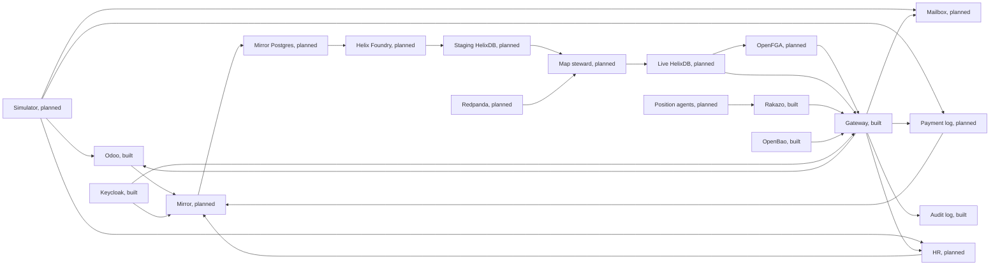

# Architecture

This is how Ramonda is laid out for the [product brief](01-product-brief.md), the [requirements](02-prd.md), and the [cafe simulator](03-demo-company.md). Security detail is in [05-security-model.md](05-security-model.md). The map's contents are in [06-ontology.md](06-ontology.md). A choice this document leaves open is recorded in [07-decisions.md](07-decisions.md).

Build only the map, the gateway, the connectors, and the simulator. Assemble the rest. Rakazo is not forked. [Decision 19](07-decisions.md#19-build-the-map-from-the-systems-and-test-with-the-simulator) is the current shape. The wave plan from PR 80 is not.

## Shape

Business systems hold the business data. A mirror copies the useful parts into Postgres, because Helix Foundry reads Postgres and has no connector for Odoo, Frappe HR, Keycloak, M-Pesa, or email. Foundry drafts types, links, mappings, and versioned `ontology.toml` and `mappings.toml`, with provenance. It loads that draft into a staging HelixDB that it owns. A Foundry refresh overwrites that staging database, so staging is not the live map.

The map steward takes the draft and adds what Foundry does not. It builds the observed chart from HR titles, manager fields, Keycloak groups, and how work actually flows. It merges messy titles onto positions. It records responsibilities and approval roles. When the company hands over a chart it already has, the steward stores that as the stated chart and compares the two. The rules are in [the ontology](06-ontology.md#the-stated-chart-and-the-observed-chart). It applies later changes from Redpanda. For a large structural change it asks Foundry for a fresh draft and merges that draft.

The steward writes the checked result into a separate live HelixDB. Only the steward updates that database. The live map holds structure and links, including change history. It does not hold sales, shifts, or payments. Agents read those live through the gateway.

OpenFGA reads the live map and decides access. Agents read the live map, through the gateway, to see where to look. The gateway is still the only door to a business system, to the live map, and to a secret.

The word in each box is the status.

Keycloak is built for sign-in. Copying its groups into the mirror is planned. The audit log is built in Postgres. Copying it to Redpanda is planned, with the outbox relay. Position agents are planned. They run on the Rakazo runtime that already exists.

## The map

Helix Foundry is the drafter. v0.1 runs the self-hosted install from [HelixDB/helix-foundry](https://github.com/HelixDB/helix-foundry), using that repository's Docker Compose. The license is Apache-2.0. It may use any model, including a local one. Do not point v0.1 at the hosted product at foundry.helix-db.com. [Decision 12](07-decisions.md#12-foundry-sees-real-client-data-only-with-the-clients-approval) still holds. v0.1 uses simulated data only.

[Decision 12](07-decisions.md#12-foundry-sees-real-client-data-only-with-the-clients-approval) still holds. Foundry may see a client's real data only with that client's own model key, or with written approval. v0.1 uses simulated data only.

Foundry does not write back to client systems. It does not decide our approvals. Its rules are not our approval rules. Approval roles live on the live map, which the steward writes.

A person is asked only when sources disagree, or when a change is sensitive. Routine updates do not wait for a person. This supersedes the older rule that a named admin approved every version. The history is [decision 3](07-decisions.md#3-the-map-goes-live-only-after-a-person-approves-it).

The live map and the OpenFGA tuples that were generated from it still change as one pair. The gateway serves one pair at a time. If the tuple write fails, the previous pair stays current. [Decision 4](07-decisions.md#4-permissions-switch-with-the-map-as-one-pair) records that switch. The person alerted on a failure is whoever holds the position for that decision.

## MCP gateway

The gateway is a Rust service. It is the only MCP endpoint an agent is given for client data. It learns the caller from a Keycloak token and asks OpenFGA. A write needs a rule on the map, or a human approval that did not come from the model. It borrows a secret from OpenBao for that call and drops it when the call returns. It writes the hash-chained audit row.

A write that needs approval is stored as pending. The gateway does not call the connector until the approving position decides in Ramonda's step. A Rakazo card is not that decision. After a successful connector call, the action and the outbox row commit in one Postgres transaction. The connector call uses an idempotency key. The relay publishes the committed row. A rolled-back action publishes nothing. The relay is Rust and is still a scaffold. Redpanda is not in the local Compose file.

The gateway ignores a tenant id or a user id written in a tool argument.

## Agent runtime

Rakazo v0.9.0 is consumed unmodified, including its web client. The local stamp sets DeepSeek as the provider when `DEEPSEEK_API_KEY` is set. We do not fork Rakazo to add a login or an approval.

An agent belongs to a position. It is one principal, with limits. When nobody asked, the gateway acts as that agent. When a person asked, the gateway acts as that person. The audit row names the agent and the accountable position.

The agent is woken by schedules and by Redpanda. It decides what matters. Our code does not contain a rule for a named scenario. Who would care is read from the map. That is [decision 5](07-decisions.md#5-agents-notice-they-are-not-scripted-per-scenario). The personal names in that decision are the old demo.

Each agent has a manual a person owns. The agent can read it and cannot edit it. The stages are watch, then suggest, then act. The agent cannot raise its own stage. A risky write waits for the approving position at every stage.

Rakazo Spaces are not the permission boundary. OpenFGA is.

## Connectors

Connectors are Python 3.12. One package per system. The gateway passes the acting identity and injects the secret. The connector does not choose the user and does not store the secret.

| System | Status in the local stamp |
| --- | --- |
| Odoo, for sales and stock | Runs. The connector requires the gateway client certificate |
| HR, Frappe HR as the stand-in | Package only. Not in Compose |
| Payment log | Simulated M-Pesa transactions. The `connectors/daraja` package is the scaffold. No money is sent. Do not treat that package as a description of a real M-Pesa message |
| Mailbox | Package `connectors/mailpit` only. Not in Compose |
| Files | Package `connectors/nextcloud` only. A report or a deck does not have to land here to be graded |

The mirror is a separate job. It is not one of these connectors. It copies into Postgres for Foundry. Agents still read live data through the gateway, not from the mirror.

## Permissions

OpenFGA allows or refuses. The tuples come from the live map's positions, responsibilities, and approval roles. A person receives access by holding a position. There is no per-person permission table. [Decision 11](07-decisions.md#11-a-job-is-not-the-same-link-as-access) is the old split and is superseded.

## Identity

The local stamp uses Keycloak. A client that already runs Microsoft Entra ID or Okta uses that provider through OIDC. The gateway trusts the OIDC subject.

Rakazo v0.9.0 is configured with the generic OIDC environment variables. Its account document does not name Keycloak. The local stamp already signs in through Keycloak. Do not fork Rakazo. Source: [self-host accounts](https://github.com/elie222/rakazo/blob/main/docs/self-host-accounts.md).

## Events

Postgres holds actions, approvals, audit rows, and the outbox. Redpanda is the bus, once it is added. Topics are prefixed by the tenant. The cafe prefix is `akwara-cafe`.

| Topic | Who writes | Who reads |
| --- | --- | --- |
| `{tenant}.changes` | Gateway, from connector events | The map steward and standing agents |
| `{tenant}.triggers` | Schedules and outside webhooks | The run those schedules and webhooks wake |
| `{tenant}.audit` | Relay, from committed audit rows | The map steward, and any export |

`{tenant}.triggers` is not a place for a scenario rule. A sale or a delivery is `{tenant}.changes`. The consumer delivers the event. The agent, or the steward, decides.

The client system is not inside the Postgres transaction. The gateway stores the action, including its idempotency key, before it calls the connector. It commits the action and the outbox row only after the connector reports success. A repeat returns the result the connector has already stored for that key. A second call that arrives before that result is stored is outside this guarantee. If the connector crashes after the client system has applied the write and before it has stored that result, the key alone does not stop a second write. How that gap is closed is not specified. Do not assume Odoo deduplicates the key. Recovery retries the same key and does not ask for a second approval. Debezium is not in v0.1. It can replace the relay later without a change to writers.

## Audit

The audit log is a Postgres table. The application role cannot update or delete a row. Each row stores the previous row's hash and the SHA-256 of that hash plus the payload. The payload is UTF-8 JSON with sorted keys. The row names the acting identity and, for an agent, the accountable position.

Email is a readable copy. The log wins if they disagree.

An alerting duty belongs to the map steward. It asks a person when sources disagree, or when a change would alter who can approve or who can see what. It cannot pause a run or edit the live map on its own authority. A person pauses an agent from the console. There is no separate watcher. [Decision 7](07-decisions.md#7-the-watcher-records-and-alerts-a-human-pauses) is the old watcher, and it is superseded.

## App and admin console

Staff use Rakazo's web client, pinned to v0.9.0. The admin console is a small TypeScript app in this repo, built with Vite, with bun as the package manager. It is not Next.js. The console package is a scaffold. It will be the place a person resolves a flagged map change, reads the log, and pauses an agent. It does not chart sales.

## Observability

OpenTelemetry is the tracer, once the collector is added. A trace for a question and a trace for an approved write should show the gateway call and the identity it acted as. No speed target is set. The collector is not in the local Compose file.

## Tenancy and isolation

One client is one stamp. The stamp has its own Rakazo, Postgres, HelixDB databases, OpenFGA store, OpenBao path, and Redpanda. A second client is a second stamp of the same images. We do not share one database and rely on a tenant column.

Inside the stamp, positions are separated by OpenFGA. A branch does not get its own Postgres.

## Reuse

| Layer | What it is | Where it lives |
| --- | --- | --- |
| Core | Gateway, relay, outbox contract, console, audit | `core/` |
| Connectors | One Python package per system | `connectors/` |
| Simulator | The cafe, then a logistics company. Not written yet | Not chosen. Do not put it in `scripts/seed_akwara_cafe.py` |
| Starting templates | Agents and position templates only. Not the map | `packs/hospitality/` |
| Client config | Manuals for this client's positions. People edit them. Agents do not | `clients/akwara-cafe/` |

`packs/hospitality/` may hold a starting set of agents and position templates. It is not the org chart. The map is always built from the company's own systems. A position manual lives in that client's directory under `clients/`. A person edits the file. The agent can read it through the gateway and cannot edit it. `clients/akwara-cafe/gateway-mcp.json` only points Rakazo at the gateway. Do not fill these directories with planted facts.

## Deployment

The local stamp is [deploy/compose.yaml](../../deploy/compose.yaml). It runs Postgres, Keycloak, OpenBao, Odoo, the Odoo connector, the gateway, and Rakazo v0.9.0. The gateway and the Odoo connector are on the Compose profile `gateway`.

It does not run HelixDB, Foundry, OpenFGA, Redpanda, Frappe HR, a payment log, a mailbox, or the simulator.

Images are pinned by tag. Rakazo is `ghcr.io/elie222/rakazo/app:v0.9.0`. The demo does not patch that image.

How to start the stamp is in the [README](../../README.md). Certificate rules are in [deploy/certs/README.md](../../deploy/certs/README.md).

## What we build and what we assemble

| We build | We assemble | Status |
| --- | --- | --- |
| MCP gateway, audit write, borrowed secrets, connector mTLS | Rakazo v0.9.0, Keycloak, OpenBao, Postgres, Odoo | Built |
| Simulator, mirror, map steward | HelixDB, Helix Foundry, OpenFGA, Redpanda | Planned |
| Position agents, approval step, console, outbox relay | The HR system, the payment log, the mailbox | Planned |

## Open questions

1. Rakazo's consent flow is still open. `verify/ramonda check 1` reaches the gateway with a Keycloak password grant. The consent step inside Rakazo runs only when `DEEPSEEK_API_KEY` is set. Do not fork Rakazo to close the gap.
2. How a connector remembers an idempotency key after a crash, and what a second call does while the first is still in flight, is still open. The events section names the gap. Do not invent an Odoo deduplication scheme to close it.
