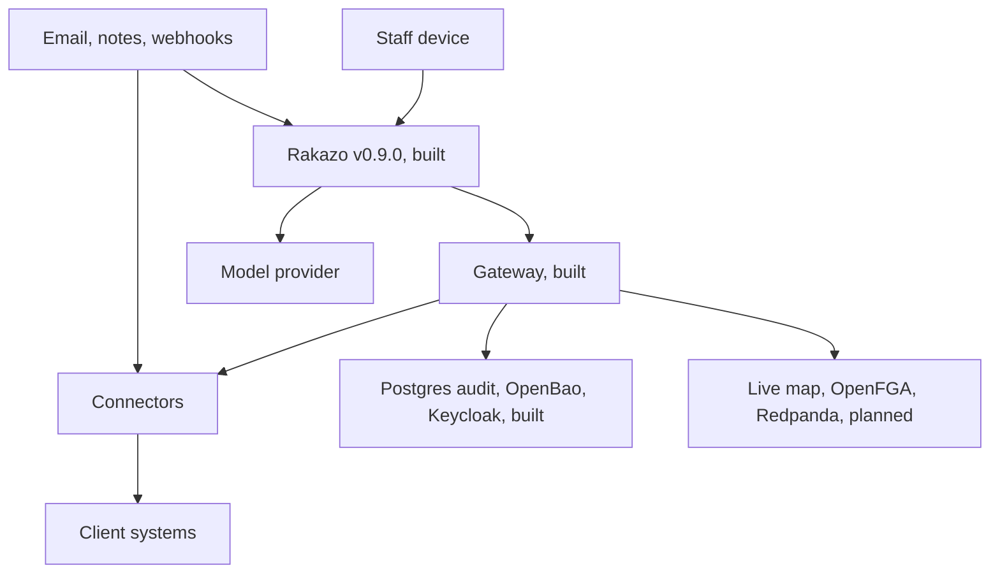

# Security model

This document lists the security claims a reviewer can check. It follows the [product brief](01-product-brief.md), the [requirements](02-prd.md), the [simulator](03-demo-company.md), and the [architecture](04-architecture.md). A claim is either a control the architecture specifies, or a control still to build. Nothing here is a certification.

The map's shape is in [06-ontology.md](06-ontology.md). Decisions are in [07-decisions.md](07-decisions.md). [Decision 19](07-decisions.md#19-build-the-map-from-the-systems-and-test-with-the-simulator) is the current product shape. [Decision 12](07-decisions.md#12-foundry-sees-real-client-data-only-with-the-clients-approval) still limits what Foundry may see.

## Purpose and scope

This document says what we protect, who may touch it, and which control stops each main abuse. It covers one client stamp and the gateway as the only door to that client's systems.

It does not choose a client's model provider. It does not give legal advice. It does not claim SOC 2 or ISO 27001. It does not describe how HelixDB stores a node.

The local Compose file runs the slice 0 and 1 plumbing. The simulator, the map, OpenFGA, approvals, and Redpanda are not built. Claims that need those parts are marked as not yet shown.

## Assets

| Asset | Where it lives | Why it matters |
| --- | --- | --- |
| Client business data | Odoo today. HR, the payment log, and the mailbox when those systems are connected | We are not the system of record. A bad call still changes their books |
| Mirror Postgres | Planned. A copy for Foundry | A copy can be stale, and it is not the live map |
| Staging HelixDB | Planned. Foundry owns it and may overwrite it | It must not be used for access |
| Live map | Planned. The HelixDB the steward writes | A wrong map widens every later check |
| Permissions | Planned. OpenFGA, filled from the live map | This is the allow or refuse decision. The model does not make it |
| Secrets | OpenBao on the local stamp | Theft here is theft of the client's systems |
| Audit log | Postgres today. Copied to `{tenant}.audit` once Redpanda exists | The record an auditor trusts when email disagrees |
| Hidden simulator record | Planned. Private to the simulator | It is the grader's source. It is not an agent input |

Staff names, shifts, and pay are personal data. Branch sales and margins are business data. Both sit behind the same door.

## Trust boundaries

The staff device and everything outside the stamp are untrusted. Rakazo is inside the stamp and must not hold a connector secret. The gateway is the boundary in front of client systems, the live map, and secrets. The model provider is outside the stamp. Email, delivery notes, payment references, and webhooks are data, not instructions.

Foundry and the staging HelixDB sit off to the side of this picture. They draft from the mirror. They are not a path to a client system, and they are not a path to an allow decision. The live map is the only HelixDB the gateway reads.

Rakazo Spaces are not a boundary. OpenFGA is, once it is running. A tool argument that names a tenant or a user is not a boundary. The gateway ignores it. The MCP OAuth token names the caller.

## Threats

| Threat | Control | What would show it |
| --- | --- | --- |
| Business text tells the agent to ignore the rules and write an order | The text is data. It cannot become an approval, an OpenFGA tuple, or a secret. The gateway refuses a write the caller's position may not make | The instruction does not change permissions or secrets, and it does not write an order that position may not make. A write the position may already make is still that position's write. Do not plant the sentence as a fixture |
| An agent reads or writes outside its position | The agent is one OpenFGA principal, with limits. The gateway acts as that principal, not as a shared login | An unattended read is audited as that agent and stays inside the position. Not built yet |
| Someone copies a connector password out of the agent or the prompt | The secret is fetched for one call and then dropped | On the local stamp the gateway reads the Odoo secret from OpenBao for the call. The agent process does not receive it |
| A user in one client reads another client's map or log | One stamp per client | Needs a second stamp. Not shown |
| A Rakazo approval card is treated as permission to write | Ramonda's own approval step is the record | A card with no Ramonda decision does not write. The approval step is not built yet |
| Someone edits or deletes an audit row | The application role cannot update or delete. Each row stores the previous hash | Recompute the chain. `verify/ramonda check 1` checks the chain on the local stamp |
| The model provider keeps or trains on client data | The provider and the contract are the client's. The local stamp uses DeepSeek when `DEEPSEEK_API_KEY` is set. We do not send connector secrets | The provider still sees the business data the caller was allowed to read |
| Foundry sends records to a model | Decision 12. Real client data needs the client's own model key or written approval. v0.1 uses simulated data only. The agreed install is self-hosted and may use a local model | A v0.1 run has no real client's tables connected to Foundry |
| A drifted image changes Rakazo | Rakazo is pinned to `ghcr.io/elie222/rakazo/app:v0.9.0` in `deploy/compose.yaml`. The stamp does not patch it | The pin is in the Compose file |
| A retried call writes the order twice, or publishes a success that never happened | The pending action stores the idempotency key before the call. A repeated key returns the stored result. The outbox row commits only after success | Specified. The relay is not built, so this is not shown |

## Identity and access

People sign in as themselves through OIDC. The local stamp uses Keycloak. A client that already has Microsoft Entra ID or Okta uses that provider instead. The local stamp already signs a person in through Keycloak and the gateway. Do not fork Rakazo to change that. Entra and Okta are not demonstrated.

When nobody asked, the gateway acts as the agent for the position. That agent is one non-human principal in OpenFGA, with limits. The audit row names the agent and the accountable position. It is not a shared password.

OpenFGA is filled from the live map when the map changes, not when a prompt asks. Access follows the position. There is no per-person permission table. The model does not grant access. A request uses one tuple pair, the previous one or the new one. Access the new map would remove stays in force until the new tuples commit. If that write fails, the previous pair stays current and the gateway retries. That window is [decision 4](07-decisions.md#4-permissions-switch-with-the-map-as-one-pair).

The gateway ignores a tenant id or a user id written inside a tool argument.

## Secrets

The local store is OpenBao. Infisical is allowed for a client that already runs it. The local stamp does not run Infisical.

The gateway reads a secret at the start of one connector call and drops it when the call returns. The agent process does not receive it. The prompt does not contain it. The source tree does not contain a production secret. Local dev values live in the Compose file and are for this laptop stamp only.

Who can read a secret is an OpenBao policy for that stamp. Rotation is replace the value in OpenBao. The next call uses the new value. No rotation period is set.

## Approvals

A write the map marks as needing a person returns pending. The gateway does not call the connector until the person who holds the approving position decides in Ramonda's step. A write the map already allows for that position proceeds, and is still audited. Text the agent read cannot add an allowance the map does not already give.

The Ramonda approval decision is the audit record. A Rakazo card is not the record. A decline writes nothing and is still an audit row.

The approval step is not built yet.

## Prompt injection and untrusted content

Business data is untrusted. That includes delivery notes, emails, payment references, webhooks, and documents. The text can be shown to a person. It cannot change an approval, an OpenFGA tuple, or a secret.

The blast radius is the caller's position, then the approval rule, then the audit row. The agent can only ask the gateway.

## Audit

The log is a Postgres table. The application role cannot update or delete a row. Email is a copy. If the copy and the log disagree, the log wins.

Each row holds the action and the acting identity. When the identity is an agent, the row also names the accountable position. A refusal is a row too.

The row stores the previous row's hash and the SHA-256 of that hash plus the payload. The payload is UTF-8 JSON with sorted keys. A reviewer verifies the chain by recomputing each hash in order. `verify/ramonda check 1` does that on the local stamp.

How long rows are kept is not set. Export to Redpanda is planned. An alerting agent may record a finding and alert the position that should hear it. It cannot pause an agent or change a record. A human pauses the agent from the console.

## Tenant isolation

One client is one stamp. Its own Rakazo, Postgres, HelixDB databases, OpenFGA store, OpenBao path, and Redpanda. Topic names start with that tenant. The cafe prefix is `akwara-cafe`. A second client does not share those stores.

Inside the stamp, positions are separated by OpenFGA. A branch does not get its own database.

An operator who works on a client's stamp is a named identity in that client's identity provider. Their actions are audit rows. There is no standing login that opens every stamp. A time limit on that access is not built.

## Data handling

Traffic inside the stamp, and from the stamp to client systems and to the model provider, must use TLS. Local Compose uses the dev CA from `deploy/certs/generate.sh`. A non-local stamp leaves `RAMONDA_STAMP` unset and supplies the certificates in [deploy/certs/README.md](../../deploy/certs/README.md). The gateway refuses to start if that stamp would use the dev CA, or plain HTTP, for the Odoo connector or for OpenBao. The Odoo connector requires the gateway's client certificate.

Data at rest is still to apply. Volume encryption for Postgres, HelixDB, and Rakazo's disk is required and not yet chosen. OpenBao is the secrets store. We do not claim that Rakazo encrypts its own data directory.

The local stamp's agent calls use DeepSeek when `DEEPSEEK_API_KEY` is set. Those calls send the prompt and the tool results the caller was allowed to see. They do not send connector secrets. Whether a client's provider may retain or train on the text is that client's contract.

Helix Foundry is a separate path. A generation sends synced tables, and a limited set of documents, to a model. The agreed v0.1 install is self-hosted and may use a local model. The public docs still describe hosted Anthropic as the default. v0.1 does not use that default. Real client data waits for decision 12.

The cafe's staff names, shifts, and pay are personal data of people in a Kenyan setting, even though the people are simulated. The Kenya Data Protection Act, 2019, is the law a real Kenyan client would be under. The Office of the Data Protection Commissioner enforces it. Which country a stamp runs in is a deployment choice. The software does not keep data inside Kenya by itself.

## Compliance readiness

This is readiness for an assessment, not a certificate. Several controls wait on the map and on approvals.

| Theme | What we can show now | Still to build |
| --- | --- | --- |
| Access control | Keycloak sign-in. The gateway ignores tool-argument identity. The Odoo read runs as the signed-in user | OpenFGA from the live map |
| Change control | Specified. A gated write waits for Ramonda's approval step. A map rule can allow a routine write | The approval step |
| Logging | Append-only hash-chained log. `verify/ramonda check 1` checks the chain | The Redpanda copy |
| Cryptography | TLS. Secrets in OpenBao for one call. The Odoo connector accepts only a gateway client certificate | Volume encryption. OpenBao TLS on a non-local stamp |
| Operations | One Compose file. Pinned Rakazo image | A second stamp. The relay |
| Incident handling | A person will pause an agent from the console. The alerting agent cannot | The console control, and a drill |

## Incident response

Detect. An alerting agent reads the audit stream and may alert the position that should hear it. Traces show the gateway call and the identity it acted as. Neither channel stops the run. The stream and the traces are not in the local stamp yet. The hash-chained log is.

Contain. A human pauses the agent in the console. The alerting agent cannot. Access is narrowed by changing the position on the live map. The narrower tuples apply when that write commits. Until then the previous pair stays current. Connector secrets are rotated in OpenBao. A pause does not unwind a write the client system already accepted.

Record. The pause, the map change, the refusal, and the rotation are audit rows.

## Open questions

These are not decided. Do not fill them in by guessing.

1. **A client's model terms.** Which provider a real client uses, and whether that provider may retain or train on prompts, is unset. The local stamp's default is DeepSeek when the key is set.
2. **Retention.** How long we keep audit rows and Rakazo transcripts is unset.
3. **Volume encryption.** Encryption of disks is required. The mechanism is not chosen.
4. **How long an operator may keep access** to a client's stamp is not chosen.
5. **Foundry's self-hosted image.** The agreed install is self-hosted, any model, including a local one. The public introduction does not document that image. Do not connect Foundry to data until the owner names the image.
