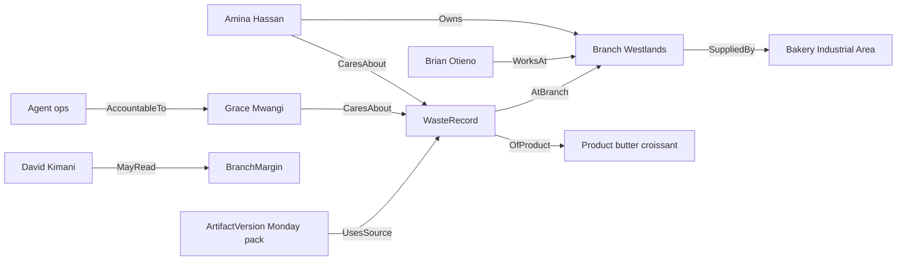

# Ontology

The map is the live model of one company. Agents reason over it. It is not a schema written for one scenario, and it is not a rule engine. This document says what the map contains, where it is stored, and how Akwara Cafe is an instance of it. It follows the [product brief](01-product-brief.md), the [product requirements](02-prd.md) (R1–R38), [Akwara Cafe](03-demo-company.md), the [architecture](04-architecture.md), and the [security model](05-security-model.md).

## Purpose

An agent needs four facts before it acts. What exists. How those things connect. What can be done to them. Who may see or do that. It also needs who cares, so it can notice a change without a script that names the change.

The map holds those facts for one client. The gateway reads it. OpenFGA, not the model, decides access (R7). A write to a client system still needs the approval rule (R12, R14).

R1 calls the map a live model. Two clocks must not be confused. Sales, deliveries, and waste are read from the client system through the gateway when the agent asks. They are not copied into HelixDB first, so they do not wait on a Foundry load. Structure, ownership, interests, and action types change only when a person approves a new map version. A reassigned owner is not live until that approval. A Westlands sale is.

## The four parts

### Objects

An object type is a kind of thing: Branch, Product, StaffMember. An instance is one of them: the Westlands branch, Amina Hassan, the butter croissant.

A type has a name and a set of properties. An instance has an id, the values of those properties, and the client system it was copied from when it has one. The id in the map is ours. The source id, such as an Odoo id, is a property, so a later change can find the same row.

Types are shared by a pack. Instances belong to one client.

### Links

A link type connects two object types and says what the connection means. `Owns` from StaffMember to Branch is not the same fact as `WorksAt`.

A link instance connects two object instances. It may have properties. `CaresAbout` can carry a short reason, such as `waste cost`, so the agent can read why the link exists. The reason is data. It is not a condition the gateway evaluates.

### Actions

An action type is something that can be done. It is stored in the map like any other type. HelixDB does not run it. The gateway does, through a connector.

An action type records:

- Its name.
- The object type it acts on.
- Its inputs.
- Preconditions the gateway can check, such as "the caller may see this branch".
- The system and connector that execute it. For Akwara Cafe, place-replenishment is Odoo Inventory.
- Whether the step changes a client system. A change to a client system is not a small reversible step. It follows the approval rules (R12, R14).
- The approval rule: who must decide, by role. For the croissant cut, that role is regional operations lead. In this company that person is Grace Mwangi.

An action instance is one proposed or completed use of that type. It points at the object, the caller, and, when a person approved it, that person. The gateway stores the pending and completed action. The map stores the type and the link from the action instance to the object, so the agent can see what was proposed.

### Permissions

OpenFGA is the allow or refuse decision. The map is the source the tuples are copied from, and only after a person has approved that map (R3, R7).

Principals are people, roles, and standing agents. A standing agent is one principal, with a role, explicit limits, and a link to the human manager who is accountable for it. The Akwara ops agent is that kind of principal. When nobody asked, the gateway acts as that principal. When a person asked, it acts as that person (R8).

Derivation is mechanical. After Nelly approves a map version, a job in the gateway reads the approved links and writes tuples. Examples: a StaffMember with `HasRole` regional operations lead can approve `PlaceReplenishment`. A StaffMember who `Owns` a Branch can read that branch's sales, deliveries, and waste. A standing agent with a role gets only the tuples of that role. The model does not write tuples.

Property-level secrets, such as branch margin and pay, are their own object types. OpenFGA can then hide them without hiding the branch or the person. David Kimani can read `BranchMargin`. Amina Hassan cannot. Brian Otieno cannot.

## Responsibility and interest

Two link types carry "who cares". They are not rules.

`Owns` says who is responsible for an instance. Amina `Owns` Westlands. Peter Njoroge `Owns` the Industrial Area bakery. Grace does not own a branch. She is the operations lead for the company.

`CaresAbout` says that a person or a role has an interest in a type or an instance, with a reason. Waste cost on a branch matters to the owner of that branch and to the regional operations lead. In Akwara Cafe that is Amina for Westlands, and Grace for every branch. The link is data the agent can read.

An always-on agent is woken by `{tenant}.changes`. It is not given a script that names waste. It reads the change, reads `Owns` and `CaresAbout`, and decides whether to raise it and to whom. Memory of what this company has treated as worth raising can inform that decision. Memory does not grant a permission and does not name an approver (R20).

Who is told is then filtered by OpenFGA. Brian is not on `CaresAbout` for waste, and he may not see waste figures. The alert does not go to him.

## Artifacts

An artifact is company work: a report, a deck, a spreadsheet, an SOP, a policy draft, a forecast, or a small internal tool (R22). It is an object. Each revision is an `ArtifactVersion`, linked to the artifact. Versions are immutable. An edit or a regeneration adds a version. It does not change the previous one (R27).

Lineage is links, not a blob of text:

- `UsesSource` from the version to the objects it was built from, such as sales and deliveries.
- `BasedOnTemplate` to a `Template`.
- `BasedOnPast` to earlier versions whose layout and tone were followed (R30).

Visibility is the narrowest source (R23). If any source is hidden from a person, the version is hidden from them. The finance deck is a document David may see. It is not a `UsesSource` of the Monday pack, and it is not offered as a style source to anyone but David (R28). Nelly's exclusion is a property on a document or template, `styleExcluded`. The style step drops those before the model sees them (R31). The Monday template she has marked approved is the default (R29).

A version is not official, and is not written to Nextcloud, until that version has its own Ramonda approval (R24, R25). Approval of an earlier version does not cover it.

## Where it lives

The approved map for one client is a HelixDB database on that client's stamp (R1, R3, R36). HelixDB is an open-source graph database with vector search and BM25 text search, written in Rust. Current documentation (docs.helix-db.com, checked for this document) describes a labeled property graph. Nodes have labels and properties. Edges have labels and properties. A write is an operation tree sent to `POST /v2/query`. The same engine also accepts Cypher and SQL. The local CLI is `helix init local`, then `helix start dev`. The default local store is in-memory. `helix start dev --disk` keeps data. The documented default port is 6969.

The current quickstart does not require a schema file before a write. Older Helix material, including some SDK examples, still shows `.hx` files with `N::` and `E::` blocks. That is not the syntax in the current writing guide, so this document does not use it. The example below is the documented TypeScript write shape, reduced to two Akwara Cafe nodes and one edge. It is not the full map, and nothing checks that a label is one of our types.

```ts
writeBatch()
  .varAs("westlands", g().addN("Branch", { name: "Westlands", neighbourhood: "Westlands" }))
  .varAs("amina", g().addN("StaffMember", { name: "Amina Hassan" }))
  .varAs(
    "owns",
    g()
      .n(NodeRef.var("amina"))
      .addE("Owns", NodeRef.var("westlands"), { kind: "owner" })
      .count(),
  )
  .returning(["westlands", "amina", "owns"]);
```

Source: the HelixDB writing-data guide. A write batch commits or rolls back as one transaction. Agents do not send this request. The gateway does.

Helix Foundry is the product that drafts an ontology. It runs at foundry.helix-db.com. Its own docs say it connects sources, asks its agent to draft types, links, mappings, document routes, rules, and questions, and stores each draft as a version. Versions do not change. An owner or admin makes one version current, then a load writes that version into the Helix database bound to the ontology. Foundry does not write back to the client's systems. It does not manage our roles or our SSO. By default its generation and document extraction use Anthropic models hosted through Helix. On a Pro or Max plan, an owner can point that at the workspace's own Anthropic key. That is a separate path from the Ramonda agent's provider, which is still unset. The control is in the [security model](05-security-model.md): Foundry may see a client's real data only with that client's own model key, or a provider the client approved in writing. Until then it drafts from Akwara Cafe's fake data only.

Foundry's draft is reviewed as a graph, as types and links, as mappings, and as `ontology.toml` plus `mappings.toml`. Edits to routes, identifiers, rules, and constraints become a new version. Changing types and links means generating again. We use that draft as a proposal. We do not treat Foundry's rules as our approval rules. Our approval rules are action types in the map.

## How the map is built and changed

1. Our connectors read Odoo, Frappe HR, Daraja, and Nextcloud. They do not give those credentials to Foundry.
2. Records and documents the client admin has chosen are available for a Foundry generation. A generation reads at most 50 tables and 20 document sets, and at most five of the newest documents in each set. That limit is Foundry's, from its generate-and-version guide.
3. Foundry's agent drafts a version. Nothing in the live map changes.
4. Nelly Achieng, the client admin, reviews it and approves it. In Foundry that approval is Make current, and only an owner or admin can do it. For Akwara Cafe, Nelly is that person. Our operators are not a standing Foundry admin of the client workspace.
5. A load writes the current version into this stamp's HelixDB.
6. The gateway writes an audit row for the approval. It then writes the OpenFGA tuples for that version. The live pair is the Helix version and the tuples that were generated from it. A request uses one pair, the previous one or the new one, never the new map with the old tuples. The gateway switches the current version only after the tuple write for that version has succeeded. A draft Nelly has not approved does not change tuples (R3, R7).

If the tuple write fails, the previous pair stays current. Access the new map would remove stays in force only while that previous pair is current. It does not stay after the new tuples commit, and there is no extra grace period. The gateway retries on startup and on a short interval. The first failure is an audit row and an alert to Nelly. It does not serve the new Helix load as current, and it does not deny the whole company.

Client systems keep changing. Our connectors publish those changes on `{tenant}.changes`. The agent reads sales and deliveries from the client system at that moment. Those records do not sit in the map waiting for Foundry.

Foundry can sync its own source snapshots on a schedule, and its product can start a load by itself when that data changes. That automatic load must not write this stamp's live HelixDB. The live database is written only in step 5, after Nelly has approved the version. A refresh that would change an `Owns`, `CaresAbout`, `HasRole`, `MayRead`, or `AccountableTo` link is a new version. It stays a proposal until she approves it, and the gateway does not switch the live pair until the tuples for that version commit. This document does not claim Foundry subscribes to Redpanda. That path is not in Foundry's docs. See Open questions.

The watcher reads `{tenant}.changes` as well as `{tenant}.audit`. If a change looks like the approved map is behind the client system, it records a finding and alerts Nelly. Examples are a new or changed manager in Frappe HR, or a new branch or supplier in Odoo. It does not edit the map, write tuples, or start a Foundry generation. Nelly still approves any new version. This stays inside the watcher limit: record a finding and alert the admin. It cannot change a record.

## Reuse

| Layer | What the map gets | Where it lives | Requirements |
| --- | --- | --- | --- |
| Core | The gateway code that reads the map, derives tuples, and refuses a write. The same code for every client. | `core/` | R33 |
| Hospitality pack | Object types, link types, and action types for a café chain. Standard roles: branch manager, barista, regional operations lead, finance analyst, bakery and supply, HR. Standard approval: a replenishment cut goes to the operations lead. No branch names and no people. | `packs/hospitality/` | R2, R34 |
| Akwara Cafe config | Instances and names: five branches, the bakery, three suppliers, forty staff, the ops agent, extra rules, and which systems are connected. | `clients/akwara-cafe/` | R34, R35 |

A second café starts from the same pack and a different config. It does not get a new type system unless that type belongs in the pack (R35).

## The Akwara Cafe map

Types below are the ones `03-demo-company.md` needs. Properties are the minimum the demo checks.

| Type | What an instance is |
| --- | --- |
| Branch | Westlands, Kilimani, Lavington, Karen, Upper Hill. |
| Bakery | The Industrial Area bakery. It does not serve the public. |
| Product | About forty menu items, including butter, almond, and pain au chocolat croissants. |
| Supplier | Rift Grain, Kinangop Butter, Aberdare Coffee. |
| PurchaseOrder | A weekly order to a supplier. |
| Replenishment | The internal bakery-to-branch order. The croissant cut writes this in Odoo. |
| Delivery | One bakery delivery note to one branch on one day. |
| Sale | Point-of-sale tickets, grouped as the demo needs for a branch and a product. |
| WasteRecord | End-of-day waste for a branch and a product. |
| BranchMargin | Product cost and branch margin. David can read it. Amina and Brian cannot. |
| StaffMember | A person. Forty of them. |
| Role | The six operating roles, plus client admin for Nelly. |
| Shift | One person's shift. Brian's mornings at Westlands are the permission test. |
| Template | `/Templates/Monday-branch-pack.pptx`, marked approved. |
| Document | A Nextcloud file used as a source or a style example. The finance deck and the excluded draft are documents. |
| Artifact | The Monday branch pack, as a continuing object. |
| ArtifactVersion | One immutable revision of that pack. |
| Agent | The Akwara ops agent. |

Key links: `WorksAt`, `HasRole`, `MayRead`, `Owns`, `CaresAbout`, `SuppliedBy`, `ToBranch`, `OfProduct`, `AtBranch`, `UsesSource`, `BasedOnTemplate`, `BasedOnPast`, `AccountableTo`. `HasRole` is the job. `MayRead` is access to a type. They are not the same link. That split is decided in [decision 11](07-decisions.md#11-a-job-is-not-the-same-link-as-access). A future rename is a new entry in that log, not an edit of this one.

Key action: `PlaceReplenishment`. It runs through the Odoo connector. It changes a client system, so it is not a small reversible step. The approval rule names the regional operations lead. The demo proposal is Westlands from 80 to 60 weekday butter croissants, and Kilimani from 50 to 38. Nothing is written until Grace approves that proposal in Ramonda's approval step.



David's job is finance analyst, a `HasRole` link to that `Role`. His access to margins is a separate `MayRead` link to `BranchMargin`. The diagram shows the access link.

## How agents use it

An agent never opens HelixDB. It calls the gateway. The gateway takes the caller's token, asks OpenFGA for the current approved pair, and only then runs a Helix read of that same version. The result is already filtered. A retrieval bug in Helix must not widen what OpenFGA refused. That is why permissions are not "whatever the graph query returned" (R7, R8).

A write is an action type. The gateway checks the precondition, the caller's tuples, and the approval rule. It then calls the connector. The agent does not.

## Open questions

1. **Foundry and Redpanda.** Foundry refreshes a load on its own schedule when its sources change. Its docs do not show a subscription to `{tenant}.changes`. We have not verified a path that turns our event into a Foundry generation without a person starting it. That gap is about structure: a new owner or a new interest. It is not about sales or deliveries. Those are read from the client system when the agent asks, so they are not stale for lack of a Foundry load. Until a verified path exists, a change on `{tenant}.changes` does not replace the approved map.
2. **Labels are not a compiled schema.** The current HelixDB quickstart accepts a node label on write. It does not show a step that rejects an unknown type. Whether we also store Foundry's `ontology.toml` as the list of allowed labels, and refuse anything else, is not decided.
