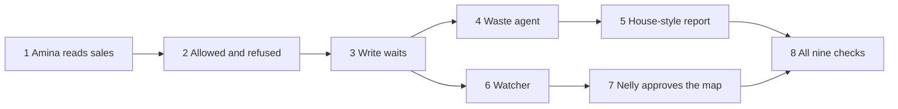

# Build plan

This is the order of work for the Akwara Cafe demo. It follows the [brief](01-product-brief.md), the [requirements](02-prd.md), the [demo company](03-demo-company.md), the [architecture](04-architecture.md), the [security model](05-security-model.md), the [ontology](06-ontology.md), and the [decisions](07-decisions.md).

Each slice is a thin path through every layer it needs. Hassan can demo it on its own. A fresh coding session that has never seen these docs should be able to finish one slice and stop. Infrastructure is not its own step. Postgres, Keycloak, Rakazo, the gateway, Odoo, HelixDB, OpenFGA, Redpanda, and OpenBao each arrive in the first slice that needs them.

We cut this way so the whole path is proven early, not after every layer is finished. After slice 3, two tracks can run at once: slices 4 and 5, and slices 6 and 7. Slice 8 waits for both tracks.

When a slice is approved, it becomes a GitHub issue. Later issues name their blockers with `gh issue create --blocked-by`. Do not open those issues until this plan is approved.

A slice's "Done when" checks must fail on the commit where that slice starts. They must not pass by accident.

## 1. Amina reads Westlands sales

**Goal.** Amina Hassan signs in and is told Westlands sales from Odoo, and the gateway writes an audit row.

**What to build.** The smallest Compose stack: Keycloak, Rakazo v0.9.0 unmodified, the gateway, Odoo Community with Point of Sale and Inventory, OpenBao, and Postgres for the audit row. Amina signs in as herself. The agent calls only the gateway. The gateway acts as Amina, reads Westlands sales and the bakery deliveries for that branch, and does not write to Odoo. No map and no OpenFGA yet. This slice trusts one signed-in user.

**Demo path.** Amina asks why croissant waste is up. The answer uses her branch's sales and deliveries. Brian cannot sign in as Amina. WhatsApp is not involved.

**Done when.** On an empty tree, Amina has no login, the agent cannot read Odoo, and there is no audit row. After the slice: she is a Keycloak user, the answer quotes the seeded Westlands figures, and one audit row names her and the read.

**Blocked by.** None.

**Requirements.** R6, R8, R9, R11, R17. Demo check 1, the read half only.

**Decisions.** [1](07-decisions.md#1-consume-rakazo-unmodified), [8](07-decisions.md#8-the-gateway-learns-who-is-calling-from-its-own-oauth-token), [14](07-decisions.md#14-the-gateway-is-the-only-door), [16](07-decisions.md#16-the-demo-secret-store-is-openbao).

## 2. David is allowed margins. Brian is refused.

**Goal.** The same question gets a different answer, and both the allow and the refuse are audited.

**What to build.** HelixDB, with a small approved slice of the Akwara Cafe map: Westlands, Amina, David Kimani, Brian Otieno, butter croissant, one waste record, one margin record. OpenFGA tuples built from that map. The gateway checks OpenFGA on every read. David may read `BranchMargin`. Brian may not read sales, waste, or margins. Amina still sees only Westlands. No hand-written exception per person.

**Demo path.** David asks why croissant waste is up and also hears the margin. Brian asks and sees neither the waste figures nor the margin. Amina still sees Westlands sales and not the margin. Each of those three calls has an audit row.

**Done when.** Before this slice, anyone who can call the gateway can read any Odoo number, and there is no HelixDB. After it, Brian's read of sales is refused, David's read of margin is allowed, and a refused call is an audit row, not a silent empty answer.

**Blocked by.** 1.

**Requirements.** R1, R4, R5, R7. Demo checks 2 and 3. Check 3's positive half, "Brian sees his shifts", needs Frappe HR. That system arrives in slice 8. This slice only proves the refusal.

**Decisions.** [4](07-decisions.md#4-permissions-switch-with-the-map-as-one-pair), [11](07-decisions.md#11-a-job-is-not-the-same-link-as-access).

## 3. A write waits for approval

**Goal.** A proposed Odoo change sits pending until a person approves it in Ramonda's own step, then the write and its event are committed together.

**What to build.** Redpanda and the outbox relay. The action `PlaceReplenishment` on the Odoo connector. The gateway returns pending and does not call Odoo. Grace Mwangi approves or declines in Ramonda's approval step, including from the staff app. A Rakazo card alone does not release the write. On approval, the gateway calls Odoo with an idempotency key, then commits the action and the outbox row. The relay publishes `{tenant}.changes` and `{tenant}.audit`. A decline writes nothing and is still audited.

**Demo path.** The agent proposes Westlands 60 and Kilimani 38 weekday butter croissants. Odoo is unchanged. Grace approves. Odoo then shows those quantities. Clicking only Rakazo's card leaves Odoo unchanged.

**Done when.** Before this slice, nothing can propose a write, and Redpanda is not running. After it, an unapproved proposal is absent from Odoo, the approval row is in our log, and the event is on `{tenant}.changes` only after the Postgres commit.

**Blocked by.** 2.

**Requirements.** R12, R13, R14, R15, R16. Demo checks 4, 5, and 6.

**Decisions.** [2](07-decisions.md#2-redpanda-from-the-start), [9](07-decisions.md#9-ramondas-approval-step-is-the-one-that-counts).

## 4. The waste agent notices

**Goal.** A standing agent, woken by a real change, decides the Westlands waste is worth raising and tells Amina and Grace, not Brian.

**What to build.** The Akwara ops agent: one OpenFGA principal, a role, limits, and Grace as the accountable human. Odoo notifies the gateway when a sale or a waste sheet is recorded. The gateway publishes that change to `{tenant}.changes`. A consumer delivers each of those events to the agent and does not classify it. The agent reads `Owns` and `CaresAbout` and decides. It may draft a note. It does not cut the order. That write still waits on slice 3's approval rule.

**Demo path.** A Westlands sale or waste sheet is recorded in Odoo. Odoo notifies the gateway, and the gateway publishes it to `{tenant}.changes`. The ops agent raises it to Amina and to Grace. Brian does not get the figures. The audit row names the ops agent and Grace. No waste rule in our code matches on "croissant".

**Done when.** Before this slice, there is no standing agent and no one is told about a new sale unless a person asks. After it, a sale or waste sheet recorded in Odoo is what wakes the agent. The alert names the right people. An attempt by the agent to write the replenishment without approval does not change Odoo. A row inserted only on the topic, with no Odoo record, is not this demo.

**Blocked by.** 3.

**Requirements.** R8, R20. The paragraph under the nine checks in the demo company doc, not one of the nine rows.

**Decisions.** [5](07-decisions.md#5-agents-notice-they-are-not-scripted-per-scenario), [6](07-decisions.md#6-one-identity-per-standing-agent).

## 5. A weekly waste report in Akwara's house style

**Goal.** The ops agent drafts one waste report that looks like the café's own packs, and a person approves that version before it is saved.

**What to build.** Nextcloud. The Monday template and the four past packs, loaded as the only style sources this caller may see. One `ArtifactVersion` with owner, source ids, and template id. Grace approves that version in Ramonda's step. The gateway then writes the file under `/Packs/`. Brian cannot open it. The finance deck is not in the style list, so its sentence is not in the report.

**Demo path.** Hassan opens the new file in Nextcloud. It uses the green, cream, and copper template and the tone of the past packs. It does not contain "Kinangop butter ran 4 points over plan in July." The log names the template and the past packs.

**Done when.** Before this slice, Nextcloud has no pack and the agent cannot save a file. After it, the file exists only after Grace's approval, and a second run is out of scope for this slice.

**Blocked by.** 4.

**Requirements.** R22, R23, R25, R28, R29, R30. Part of demo check 9. Version 2, the excluded draft, and per-version re-approval are slice 8.

**Decisions.** [9](07-decisions.md#9-ramondas-approval-step-is-the-one-that-counts), [12](07-decisions.md#12-foundry-sees-real-client-data-only-with-the-clients-approval). This slice does not point Foundry at a real client. Style files are the fake café's.

## 6. The watcher catches a stale map

**Goal.** A new branch or supplier on `{tenant}.changes` makes the watcher record a finding and alert Nelly Achieng. The map does not change.

**What to build.** The watcher as a Rakazo agent with a read-only gateway tool. It reads `{tenant}.changes` and `{tenant}.audit`. It has no write tools. Plant one change that means a new supplier or a new branch. Nelly gets the alert. HelixDB and OpenFGA are unchanged after the alert.

**Demo path.** Hassan shows the event, then Nelly's alert, then the map still listing only Westlands, as slice 2 left it. The five branches and three suppliers are not in the map yet. Slice 8 is where that full map is shown.

**Done when.** Before this slice, nobody is told that the map is behind, and nothing records a finding. After it, the finding and the alert exist, and a diff of the map is empty.

**Blocked by.** 3. It does not need slice 4 or 5. It can run beside them.

**Requirements.** R18.

**Decisions.** [7](07-decisions.md#7-the-watcher-records-and-alerts-a-human-pauses).

## 7. Nelly approves a map change

**Goal.** Nelly approves one map change, and the live map and its tuples switch together. A forced failure leaves the old pair in place and alerts her.

**What to build.** The admin console: roles, connected systems, approval rules, the audit log, evals, template marks, and pause. A proposed link, for example Amina no longer owns Westlands. The gateway writes tuples for the new version and switches only after that write commits. A test flag fails the tuple write once. The previous pair stays current. Nelly is alerted. The new Helix load is not served. Retry then succeeds, and the pair switches. There is no extra grace period.

**Demo path.** Hassan runs the forced failure and shows Amina can still read Westlands. He runs the retry and shows the new ownership. The watcher does not perform this change.

**Done when.** Before this slice, there is no console and no way to fail a tuple write on purpose. After it, the failed attempt does not leave new map data readable, and the successful retry does.

**Blocked by.** 6.

**Requirements.** R3, R7, R32.

**Decisions.** [3](07-decisions.md#3-the-map-goes-live-only-after-a-person-approves-it), [4](07-decisions.md#4-permissions-switch-with-the-map-as-one-pair).

## 8. The full demo

**Goal.** All nine checks in the demo company doc pass on one reset of the seed.

**What to build.** What the earlier slices left out. Frappe HR, so Brian sees only his own shifts. Mailpit, so Grace's approval has an email copy and the log still wins if the mail is wrong. The mobile client, so the question, the approval, and an alert work there as well as on the web. The rest of the Monday pack: the excluded smoked-salt draft is not a style source, a second run keeps version 1 and writes version 2, and version 2 is not official until Grace approves it. The planted delivery note does not set orders to zero. The seed script resets only this tenant.

**Demo path.** Hassan runs the nine checks in order, from Amina's question through the second pack version. He shows the map now listing the five branches and three suppliers. He also shows the planted note refused.

**Done when.** Before this slice, check 3 has no shifts to show, check 7 has no mailbox, check 8 has not been run on mobile, and check 9 has no version 2. After it, each of the nine rows in `03-demo-company.md` can be pointed at a passing result, and the seed can be reset and run again.

**Blocked by.** 5 and 7.

**Requirements.** R19, R21, R24, R27, R31, R37, and the rest of R1 for the five branches, the bakery, the products, the forty staff, and the three suppliers. Demo checks 1 through 9.

**Decisions.** [10](07-decisions.md#10-one-stamp-per-client), [15](07-decisions.md#15-the-audit-log-wins-over-the-email).

## What these slices do not build

Daraja, a second client stamp, and a second connector client are not in the nine checks. They are not slices here. R10, R33's second client, and R36 wait until a later plan. Foundry is not pointed at a real client's data. The demo map can be loaded from the hospitality pack plus Akwara Cafe config without a Foundry call. That is [decision 12](07-decisions.md#12-foundry-sees-real-client-data-only-with-the-clients-approval).
