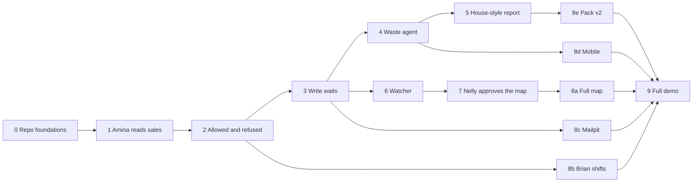

# Build plan

This is the order of work for the Akwara Cafe demo. It follows the [brief](01-product-brief.md), the [requirements](02-prd.md), the [demo company](03-demo-company.md), the [architecture](04-architecture.md), the [security model](05-security-model.md), the [ontology](06-ontology.md), and the [decisions](07-decisions.md).

Slices 1 to 7, and slices 8a to 8e, are each a thin path through every layer they need. Hassan can demo each of those on its own. Slice 9 runs the nine checks on one reset. Slice 0 is the guarded repo they start from. It is not a demo. A fresh coding session that has never seen these docs should be able to finish one slice and stop. Infrastructure is not its own step. Postgres, Keycloak, Rakazo, the gateway, Odoo, HelixDB, OpenFGA, Redpanda, OpenBao, and the OpenTelemetry collector each arrive in the first slice that needs them. Slice 0 does not start them.

The code a slice builds uses three languages ([decision 17](07-decisions.md#17-the-gateway-and-the-relay-are-rust-connectors-are-python-the-console-is-typescript)). The gateway and the outbox relay are Rust. Connectors are Python 3.12, typed, using the official MCP Python SDK. The admin console is TypeScript, built with Vite, with bun as the package manager. [Slice 0](#0-repo-foundations) creates those homes before slice 1 writes any behaviour ([decision 18](07-decisions.md#18-guard-the-repo-before-feature-work)).

We cut this way so the whole path is proven early, not after every layer is finished. After slice 3, two tracks can run at once: slices 4 and 5, and slices 6 and 7. Slice 8a waits for slice 7. Slice 8b waits for slice 2. Slice 8c waits for slice 3. Slice 8d waits for slice 4. Slice 8e waits for slice 5. Slice 9 waits for 8a through 8e.

When a slice is approved, it becomes a GitHub issue. Later issues name their blockers with `gh issue create --blocked-by`. Do not open those issues until this plan is approved.



A slice's "Done when" checks must fail on the commit where that slice starts. They must not pass by accident.

## 0. Repo foundations

**Goal.** Before any feature work, the repo is a clean base for an AI coding agent. There is no human team. A mistake is corrected in the structure or in a check.

**What to build.** The directories in [architecture, Reuse](04-architecture.md#reuse), scaffolded and empty of behaviour.

- `core/` is a Cargo workspace. Members are `gateway/`, `relay/`, and `outbox/`. `outbox/` is the shared contract crate for the outbox table. `core/console/` is the admin console: TypeScript, Vite, bun. It is not a Cargo member. The gateway still serves the built console, as [Deployment](04-architecture.md#deployment) describes.
- `connectors/` is one Python 3.12 package per system: `odoo`, `frappe_hr`, `daraja`, `nextcloud`, `mailpit`. Daraja is a package here. It stays out of the compose file, as Deployment already says.
- `packs/hospitality/` and `clients/akwara-cafe/` are config only.
- `deploy/` holds the one compose file for the stamp.
- `scripts/` is the home of `scripts/seed_akwara_cafe.py` from the [demo company](03-demo-company.md#how-the-data-is-generated-and-reset). This slice does not write that script. Slice 1 writes the minimal seed, Westlands sales. Later slices extend that same script.
- `specs/` is the TLA+ directory. This slice does not write a model.
- `verify/` holds the feature-map stub and the `ramonda` control CLI.
- `AGENTS.md` is at the repo root.

Boundaries fail in CI. The error names the allowed alternative.

- Cargo: `relay` does not depend on `gateway`. Both may depend on `outbox`. The error says to use `outbox`.
- import-linter: a connector does not import another connector, and does not import `core`. The error says to go through the gateway.
- dependency-cruiser: `core/console` imports only its own code and the gateway API types. The error names those types. Biome stays the TypeScript linter.
- `packs/` and `clients/` have no package manifest. Nothing may import them. The error says to read the files as config.

Warnings are errors. Rust is rustfmt, and clippy with `-D warnings` and pedantic. Python is ruff, pyright strict, and pytest. TypeScript is `tsc` strict and Biome. That is the full set. Pytest is set so a package with no tests yet exits clean. Toolchain versions are pinned in the repo.

A comment may be a license header, a public API doc, or a link that explains an external constraint we cannot change. A public API doc is rustdoc on a public item, a docstring on a public Python function, or TSDoc on an exported TypeScript symbol. Any other comment fails the lint job. The check is a step in that job, beside clippy, ruff, and Biome. The error tells the agent to make it a type, a lint, or a test. A Ponytail `shortcut:` comment fails the same check.

A hot-path source file is named `*.hot.rs`. The name means no blocking call, no allocation added to avoid one, and no timer used as a patch. Clippy denies blocking, allocating, and timer APIs in files of that name, and allows them elsewhere. The error tells the agent to fix the structure.

`AGENTS.md` stays thin. It states the languages and their homes, the Ponytail rule, that folders are the architecture, that comments do not narrate, and that done means the feature-map entry was driven and the evidence captured. The Ponytail rule is one line: write the least new code, and take the first rung of the [Ponytail ladder](https://github.com/DietrichGebert/ponytail/blob/main/skills/ponytail/SKILL.md) that fully works. It points at that skill for the rungs. A table pairs each rule with what enforces it.

| Rule | Enforced by |
| --- | --- |
| Languages have homes. Rust is `core/gateway`, `core/relay`, and `core/outbox`. Python 3.12 connector packages live under `connectors/`. `scripts/seed_akwara_cafe.py` is the one other Python file. TypeScript is `core/console`. | A CI check of tracked paths. A Rust, Python, or TypeScript file outside its home fails that check. The seed script is the exception. Cargo, import-linter, and dependency-cruiser check imports, not where a file sits. |
| Least new code. Take the first rung of the Ponytail ladder that fully works. | `.cursor/rules/ponytail.mdc` and the Ponytail skill. This row is prose. The rows below are checks. |
| Folders are the architecture. | The boundary checks. The error names the folder that may do the job. |
| Comments do not narrate. | The comment check in the lint job. |
| Done means the feature-map entry was driven and the evidence captured. | `verify/feature-map.md` and the `ramonda` CLI. |

`verify/feature-map.md` lists the nine Akwara Cafe checks in [Demo scenarios](03-demo-company.md#demo-scenarios). Each row links the check to the requirement IDs in that table. R4 and R5 link to [Permissions](02-prd.md#permissions). R8 links to [Gateway and connectors](02-prd.md#gateway-and-connectors). R12 and R13 link to [Approvals](02-prd.md#approvals). R15, R16, and R17 link to [Audit and events](02-prd.md#audit-and-events). R19 links to [App and notifications](02-prd.md#app-and-notifications). R21 links to [Email](02-prd.md#email). R22 through R31 link to [Artifacts](02-prd.md#artifacts). `verify/ramonda` is the control CLI. It runs, and it has no commands yet. [`/create-verification-skill`](https://github.com/cursor/plugins/tree/main/pstack/skills/create-verification-skill) fills this map and this CLI in once the stamp boots. The skill extends `verify/`.

pstack and Ponytail are installed for coding agents from the repo. `.cursor/settings.json` enables the public-marketplace plugin `pstack`, and enables Ponytail from `https://github.com/DietrichGebert/ponytail` at a pinned git ref:

```json
{
  "plugins": {
    "pstack": { "enabled": true },
    "ponytail": {
      "enabled": true,
      "gitUrl": "https://github.com/DietrichGebert/ponytail",
      "gitRef": "<pinned commit>"
    }
  }
}
```

`pstack` stays `{ "enabled": true }`. That name is the public marketplace plugin, and Cursor installs its reviewed release. A git URL for `https://github.com/cursor/plugins` would pin the marketplace repo, not the `pstack/` plugin, so this entry has no `gitRef`. Ponytail is not on that marketplace. Its `gitRef` is a full commit SHA, and the same commit's always-on rule is copied to `.cursor/rules/ponytail.mdc`. Cloud agents do not run Ponytail's `sessionStart` hook, so the rule file is what they read.

TLA+ models land in the same slice as the code they cover. They are not written in slice 0. The outbox and relay recovery model is slice 3. The approval and permission state machine is slice 3 as well: that is the slice where a write is pending, approved, or declined, and where the permission check from slice 2 becomes part of that path. Both models go in `specs/`.

**Demo path.** None. This slice has no staff journey.

**Done when.** On an empty tree there is no CI, a boundary is not checked, a narrating comment is not rejected, and `AGENTS.md` and the feature map are absent. After this slice: CI is green on the empty scaffold, a deliberate boundary violation fails CI, a narrating comment fails lint, and `AGENTS.md`, `verify/feature-map.md`, and `verify/ramonda` exist.

**Blocked by.** None.

**Requirements.** None. The layout is the one R33 and R35 describe. This slice does not close them. The nine checks are listed in the stub. They are not run.

**Decisions.** [13](07-decisions.md#13-assemble-what-is-mature-build-only-what-is-different), [17](07-decisions.md#17-the-gateway-and-the-relay-are-rust-connectors-are-python-the-console-is-typescript), [18](07-decisions.md#18-guard-the-repo-before-feature-work).

## 1. Amina reads Westlands sales

**Goal.** Amina Hassan signs in and is told Westlands sales from Odoo, and the gateway writes an audit row.

**What to build.** The smallest Compose stack: Keycloak, Rakazo v0.9.0 unmodified, the gateway, Odoo Community with Point of Sale and Inventory, OpenBao, and Postgres for the audit row. The gateway is Rust from day one, with no Python stopgap. The Odoo connector is Python 3.12, typed, using the official MCP Python SDK. Amina signs in as herself. The agent calls only the gateway. The gateway acts as Amina, reads Westlands sales and the bakery deliveries for that branch, and does not write to Odoo. This slice writes `scripts/seed_akwara_cafe.py` with those Westlands figures. Later slices extend that script. They do not start a second one. No map and no OpenFGA yet. This slice trusts one signed-in user. It has to show the Rust gateway speaking MCP to Rakazo with Keycloak OAuth before a later slice builds on it.

**Demo path.** Amina asks why croissant waste is up. The answer uses her branch's sales and deliveries. Brian cannot sign in as Amina. WhatsApp is not involved.

**Done when.** On an empty tree, Amina has no login, the agent cannot read Odoo, and there is no audit row. After the slice: she is a Keycloak user, the answer quotes the seeded Westlands figures, and one audit row names her and the read. Rakazo reached that Rust gateway over MCP with a Keycloak OAuth token issued for Amina.

**Blocked by.** 0.

**Requirements.** R6, R8, R9 for Odoo only, R11, R17 for the read row. Demo check 1, the read half only. Frappe HR's part of R9 is slice 8b. Nextcloud's is slice 5. Mailpit's is slice 8c. Daraja's part of R9 is not in this plan.

**Decisions.** [1](07-decisions.md#1-consume-rakazo-unmodified), [8](07-decisions.md#8-the-gateway-learns-who-is-calling-from-its-own-oauth-token), [14](07-decisions.md#14-the-gateway-is-the-only-door), [16](07-decisions.md#16-the-demo-secret-store-is-openbao), [17](07-decisions.md#17-the-gateway-and-the-relay-are-rust-connectors-are-python-the-console-is-typescript).

## 2. David is allowed margins. Brian is refused.

**Goal.** The same question gets a different answer, and both the allow and the refuse are audited.

**What to build.** HelixDB, with a small approved slice of the Akwara Cafe map: Westlands, Amina, David Kimani, Brian Otieno, butter croissant, one waste record, one margin record. OpenFGA tuples built from that map. The gateway checks OpenFGA on every read. David may read `BranchMargin`. Brian may not read sales, waste, or margins. Amina still sees only Westlands. No hand-written exception per person.

**Demo path.** David asks why croissant waste is up and also hears the margin. Brian asks and sees neither the waste figures nor the margin. Amina still sees Westlands sales and not the margin. Each of those three calls has an audit row.

**Done when.** Before this slice, anyone who can call the gateway can read any Odoo number, and there is no HelixDB. After it, Brian's read of sales is refused, David's read of margin is allowed, and a refused call is an audit row, not a silent empty answer.

**Blocked by.** 1.

**Requirements.** R1, R4, R5, R7 for reads. Demo checks 2 and 3. Check 3's positive half, "Brian sees his shifts", needs Frappe HR. That system arrives in slice 8b. This slice only proves the refusal. The order-cut write half of R7 is slice 3.

**Decisions.** [4](07-decisions.md#4-permissions-switch-with-the-map-as-one-pair), [11](07-decisions.md#11-a-job-is-not-the-same-link-as-access).

## 3. A write waits for approval

**Goal.** A proposed Odoo change sits pending until a person approves it in Ramonda's own step, then the write and its event are committed together.

**What to build.** Redpanda and the Rust outbox relay, in the same Cargo workspace as the gateway. The action `PlaceReplenishment` on the Odoo connector. The gateway checks OpenFGA on the write. A refused write is an audit row and does not call Odoo. An allowed write returns pending and does not call Odoo. Grace Mwangi approves or declines in Ramonda's approval step, including from the staff app. A Rakazo card alone does not release the write. On approval, the gateway calls Odoo with an idempotency key, then commits the action and the outbox row. The relay publishes `{tenant}.changes` and `{tenant}.audit`. A decline writes nothing and is still audited. This slice writes the TLA+ model of outbox and relay recovery, and the approval and permission state machine, in `specs/`. Slice 0 only created that directory. Extend `scripts/seed_akwara_cafe.py` with the Kilimani weekday butter-croissant line this cut changes. An OpenTelemetry collector receives two gateway traces: the permissioned question, and this approved write. Each trace names the person the gateway acted as.

**Demo path.** The agent proposes Westlands 60 and Kilimani 38 weekday butter croissants. Odoo is unchanged. Grace approves. Odoo then shows those quantities. Clicking only Rakazo's card leaves Odoo unchanged.

**Done when.** Before this slice, nothing can propose a write, Redpanda is not running, and `specs/` has no model. After it, an unapproved proposal is absent from Odoo, the approval row is in our log, the event is on `{tenant}.changes` only after the Postgres commit, and `specs/` holds the outbox and relay recovery model and the approval and permission state machine. The permissioned question and the approved write each have a trace through the gateway that names the person it acted as.

**Blocked by.** 2.

**Requirements.** R7 for the order-cut write, R8 for that write as the person who asked, R12, R13, R14, R15, R16, R17. Demo checks 4, 5, and 6. The observability check in the requirements. The conflicting-email half of R17 is slice 8c.

**Decisions.** [2](07-decisions.md#2-redpanda-from-the-start), [9](07-decisions.md#9-ramondas-approval-step-is-the-one-that-counts), [17](07-decisions.md#17-the-gateway-and-the-relay-are-rust-connectors-are-python-the-console-is-typescript).

## 4. The waste agent notices

**Goal.** A standing agent, woken by a real change, decides the Westlands waste is worth raising and tells Amina and Grace, not Brian.

**What to build.** The Akwara ops agent: one OpenFGA principal, a role, limits, and Grace as the accountable human. It has its own Keycloak client. The gateway acts as the agent with the token from that client. Odoo notifies the gateway when a sale or a waste sheet is recorded. The gateway writes that change and an outbox row. The relay publishes it to `{tenant}.changes`. A consumer delivers each of those events to the agent and does not classify it. The agent reads `Owns` and `CaresAbout` and decides. It may draft a note. It does not cut the order. That write still waits on slice 3's approval rule.

**Demo path.** A Westlands sale or waste sheet is recorded in Odoo. Odoo notifies the gateway. The gateway writes the change and an outbox row, and the relay publishes `{tenant}.changes`. The ops agent raises it to Amina and to Grace. Brian does not get the figures. The audit row names the ops agent and Grace. No waste rule in our code matches on "croissant".

**Done when.** Before this slice, there is no standing agent and no one is told about a new sale unless a person asks. After it, a sale or waste sheet recorded in Odoo is what wakes the agent: the outbox row, then the relay. The alert names the right people. The gateway acts as the ops agent with a token from that agent's own Keycloak client. A run that acts as the agent with any other credential does not pass. An attempt by the agent to write the replenishment without approval does not change Odoo. A row placed on `{tenant}.changes` with no Odoo record behind it does not pass.

**Blocked by.** 3.

**Requirements.** R8, R20. The paragraph under the nine checks in the demo company doc, not one of the nine rows.

**Decisions.** [5](07-decisions.md#5-agents-notice-they-are-not-scripted-per-scenario), [6](07-decisions.md#6-one-identity-per-standing-agent), [8](07-decisions.md#8-the-gateway-learns-who-is-calling-from-its-own-oauth-token).

## 5. A weekly waste report in Akwara's house style

**Goal.** The ops agent drafts one waste report that looks like the café's own packs, and a person approves that version before it is saved.

**What to build.** Nextcloud, using the `nextcloud` package slice 0 scaffolded. The Monday template and the four past packs, loaded as the only style sources this caller may see. Extend `scripts/seed_akwara_cafe.py` with that template, those packs, and the finance deck. One `ArtifactVersion` with owner, source ids, and template id. Grace approves that version in Ramonda's step. The gateway then writes the file under `/Packs/`. Brian cannot open it. The finance deck is not in the style list, so its sentence is not in the report. The create is an audit row: actor, operation, version, and sources.

**Demo path.** Hassan opens the new file in Nextcloud. It uses the green, cream, and copper template and the tone of the past packs. It does not contain "Kinangop butter ran 4 points over plan in July." The log names who acted, that it was a create, the version, the sources, the template, and the past packs.

**Done when.** Before this slice, Nextcloud has no pack and the agent cannot save a file. After it, the file exists only after Grace's approval, and a second run is out of scope for this slice.

**Blocked by.** 4.

**Requirements.** R9 for Nextcloud, R22, R23, R25, R26 for the create, R28, R29, R30. Part of demo check 9. Version 2, the excluded draft, per-version re-approval, and the edit half of R26 are slice 8e.

**Decisions.** [9](07-decisions.md#9-ramondas-approval-step-is-the-one-that-counts), [12](07-decisions.md#12-foundry-sees-real-client-data-only-with-the-clients-approval). This slice does not point Foundry at a real client. Style files are the fake café's.

## 6. The watcher catches a stale map

**Goal.** A new branch or supplier on `{tenant}.changes` makes the watcher record a finding and alert Nelly Achieng. The map does not change.

**What to build.** The watcher as a Rakazo agent with a read-only gateway tool. It reads `{tenant}.changes` and `{tenant}.audit`. It has no write tools. Plant one change that means a new supplier or a new branch. Nelly gets the alert. HelixDB and OpenFGA are unchanged after the alert.

**Demo path.** Hassan shows the event, then Nelly's alert, then the map still listing only Westlands, as slice 2 left it. The five branches and three suppliers are not in the map yet. Slice 8a is where that full map is shown.

**Done when.** Before this slice, nobody is told that the map is behind, and nothing records a finding. After it, the finding and the alert exist, and a diff of the map is empty.

**Blocked by.** 3. It does not need slice 4 or 5. It can run beside them.

**Requirements.** R18.

**Decisions.** [7](07-decisions.md#7-the-watcher-records-and-alerts-a-human-pauses).

## 7. Nelly approves a map change

**Goal.** Nelly approves one map change, and the live map and its tuples switch together. A forced failure leaves the old pair in place and alerts her.

**What to build.** The admin console is TypeScript, built with Vite, with bun as the package manager. It is not Next.js. It covers roles, connected systems, approval rules, the audit log, evals, template marks, and pause. A proposed link, for example Amina no longer owns Westlands. The gateway writes tuples for the new version and switches only after that write commits. A test flag fails the tuple write once. The previous pair stays current. Nelly is alerted. The new Helix load is not served. Retry then succeeds, and the pair switches. There is no extra grace period.

**Demo path.** Hassan runs the forced failure and shows Amina can still read Westlands. He runs the retry and shows the new ownership. The watcher does not perform this change.

**Done when.** Before this slice, there is no console and no way to fail a tuple write on purpose. After it, the failed attempt does not leave new map data readable, and the successful retry does.

**Blocked by.** 6.

**Requirements.** R32. The read half of R7 is slice 2 and the order-cut write half is slice 3. This slice switches the pair those checks use. R3 is not this slice. No Foundry draft is built here.

**Decisions.** [3](07-decisions.md#3-the-map-goes-live-only-after-a-person-approves-it), [4](07-decisions.md#4-permissions-switch-with-the-map-as-one-pair), [17](07-decisions.md#17-the-gateway-and-the-relay-are-rust-connectors-are-python-the-console-is-typescript).

## 8a. The full map and the seed reset

**Goal.** The live map is the whole company, loaded from the hospitality pack plus Akwara Cafe config, and the seed script resets only this tenant.

**What to build.** The rest of the map from slice 2: the five branches, the bakery, the products, the forty staff, and the three suppliers. This replaces that small map. The load is the hospitality pack plus `clients/akwara-cafe/` config, not a Foundry draft. Amina owns Westlands in that load and still sees only that branch. David may still read margins. Brian may still read only his shifts. A name or an org-chart entry changes by editing that config. Extend `scripts/seed_akwara_cafe.py` with that company, and keep rows an earlier slice already added. A rerun deletes only this tenant and loads it back. Later slices that extend the script keep that limit.

**Demo path.** Hassan shows the map listing the five branches and three suppliers. He changes a name in the config and the map follows, with no code change. He runs the seed again and only this tenant's data is replaced.

**Done when.** Before this slice, the map is still the small one from slice 2. After it, the map has the five branches, the bakery, the products, the forty staff, and the three suppliers, a config edit changes a name without a code change, and a rerun of the script deletes only this tenant.

**Blocked by.** 7.

**Requirements.** The rest of R1. R2.

**Decisions.** [10](07-decisions.md#10-one-stamp-per-client).

## 8b. Brian sees his shifts

**Goal.** Brian asks why croissant waste is up and sees only his own shifts.

**What to build.** Frappe HR, using the `frappe_hr` package slice 0 scaffolded. The connector is an API wrapped as MCP. Extend `scripts/seed_akwara_cafe.py` with shifts, including Brian's mornings at Westlands. The gateway reads them as Brian. OpenFGA allows that read and still refuses him sales, waste, and margins.

**Demo path.** Brian asks and sees his shifts. He does not see the waste figures or the margin.

**Done when.** Before this slice, check 3 has no shifts to show. After it, Brian's answer is only his shifts.

**Blocked by.** 2.

**Requirements.** The shifts half of R4. R9 for Frappe HR. Demo check 3, the positive half.

**Decisions.** [11](07-decisions.md#11-a-job-is-not-the-same-link-as-access).

## 8c. The approval email

**Goal.** An email copy of Grace's approval arrives, and the log still wins if the mail is wrong.

**What to build.** Mailpit, using the `mailpit` package slice 0 scaffolded. The connector is an API wrapped as MCP. The approved order cut sends a readable copy. If the mail is missing or wrong, the audit row is unchanged.

**Demo path.** Hassan reads the approval in Mailpit. He shows a mail that disagrees with the log. The log is the record.

**Done when.** Before this slice, check 7 has no mailbox. After it, the approved action has an email a person can read, and a conflicting mail does not override the log.

**Blocked by.** 3.

**Requirements.** R21. R9 for Mailpit. The conflicting-email sentence of R17. Demo check 7.

**Decisions.** [15](07-decisions.md#15-the-audit-log-wins-over-the-email).

## 8d. The same path on mobile

**Goal.** The question, the approval, and an alert work on mobile as well as on the web.

**What to build.** Rakazo's mobile client, pinned to v0.9.0, not a client we write. Amina's question, Grace's approval in Ramonda's step, and the waste alert run there. WhatsApp is not used.

**Demo path.** Hassan asks, approves, and receives the alert on the phone. The same three work on the web. There is no WhatsApp step.

**Done when.** Before this slice, check 8 has not been run on mobile. After it, the question, Ramonda's approve or decline, and a push alert work on mobile and on the web.

**Blocked by.** 4.

**Requirements.** R19. Demo check 8. The web path is Rakazo, from slice 1. This slice is the mobile half.

**Decisions.** [1](07-decisions.md#1-consume-rakazo-unmodified).

## 8e. Pack version 2 and the planted note

**Goal.** A second Monday pack keeps version 1 and writes version 2, the excluded draft is not a style source, and the planted delivery note does not change an order.

**What to build.** Extend `scripts/seed_akwara_cafe.py` with the excluded smoked-salt draft and the planted sentence on a Westlands delivery note. The exclusion is config in `clients/akwara-cafe/`. Slice 7 is the console that edits template marks. The draft is not a style source. A second run keeps version 1 and writes version 2. Version 2 is not official until Grace approves that version. The audit row for the edit names the actor, the operation, the new version, and the point-of-sale and bakery sources. The planted sentence does not change the replenishment, a permission, or a secret.

**Demo path.** Hassan shows version 1 still stored, version 2 not official, and the smoked-salt line absent from the pack. He shows the planted note refused and Odoo unchanged.

**Done when.** Before this slice, check 9 has no version 2 and the planted note has not been refused. After it, version 2 needs its own approval, the excluded draft is not used as an example, and the planted instruction does not write the order.

**Blocked by.** 5.

**Requirements.** R24, R26 for the edit, R27, R31, R37.

**Decisions.** [9](07-decisions.md#9-ramondas-approval-step-is-the-one-that-counts).

## 9. The full demo

**Goal.** All nine checks in the demo company doc pass on one reset of the seed.

**What to build.** No new system. Reset this tenant with `scripts/seed_akwara_cafe.py` and run the nine checks in order.

**Demo path.** Hassan runs the nine checks in order, from Amina's question through the second pack version. He shows the map listing the five branches and three suppliers. He also shows the planted note refused.

**Done when.** Before this slice, the nine checks have not been run together on one reset. After it, each of the nine rows in `03-demo-company.md` can be pointed at a passing result, and the seed can be reset and run again.

**Blocked by.** 8a, 8b, 8c, 8d, and 8e.

**Requirements.** Demo checks 1 through 9.

**Decisions.** None.

## What these slices do not build

Daraja, a second client stamp, and a second connector client are not in the nine checks. They are not slices here. R10, R33's second client, and R36 wait until a later plan. Daraja's part of R9 waits with them. R38 waits with them too: a reviewer cannot find the R36 evidence it asks for until a second tenant exists.

R34 and R35 are not slices. Every slice keeps Akwara Cafe in the hospitality pack and client config, and a one-off request goes into core, a connector, a pack, or config. Slice 0 scaffolds those homes and does not close R35. No slice adds café-only code.

R3 is not closed here. Slice 2 stores the map in HelixDB. No slice produces a Foundry draft. Slice 8a loads the demo map from the hospitality pack plus Akwara Cafe config, without a Foundry call. Foundry is not pointed at a real client's data. That is [decision 12](07-decisions.md#12-foundry-sees-real-client-data-only-with-the-clients-approval).
